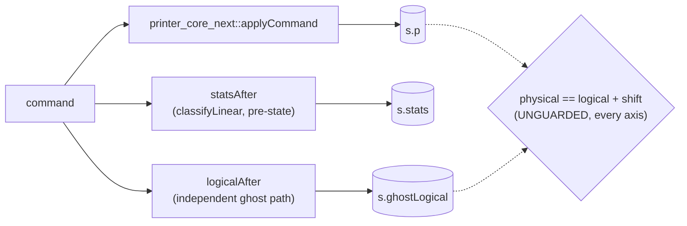
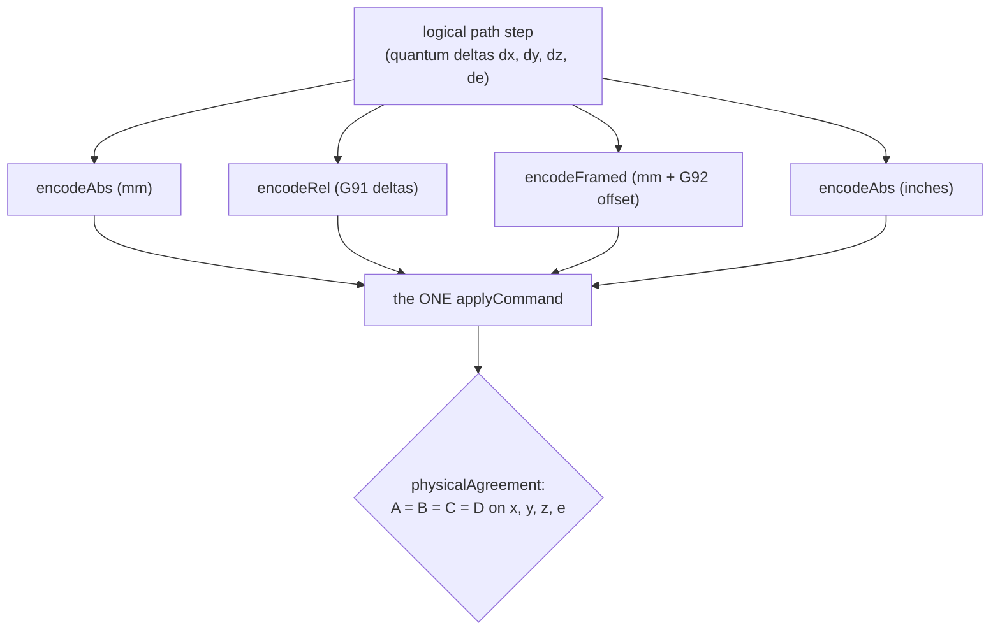

# interpreter.qnt — the interpreter machine and its equivalence theorems

Companion to `interpreter.qnt` (modules `interpreter_next` and
`encoding_equivalence_next` — one file set, two machines, documented below).

This file belongs to the **quint-next** bank: the normative, spec-first
redesign of gcode-preview's semantics. It answers "what would work better if we
designed it from scratch", not "what does the code do today". Where it differs
from the current implementation, the difference is intentional and listed in
the Divergence ledger.

## What it specifies

`interpreter_next` is the machine that folds the from-scratch core. It runs
`printer_core_next::applyCommand` over a nondeterministic stream drawn from the
full designed alphabet — G90/G91 included — and adds only what the core does
not own: the job-statistics fold through the core's state-aware
`classifyLinear`, the ghost logical positions with the defining-equation
invariant, two conservation ghosts for the stats partition, and the event
record.

`encoding_equivalence_next` is the theorem bank the design makes possible. One
logical toolpath — a sequence of per-axis quantum deltas — is re-encoded by
pure functions into four G-code streams: absolute millimeters (A), relative
G91 deltas (B), absolute millimeters through a G92 workspace (C), and absolute
inches under G20 (D). All four fold the same `applyCommand`, and the headline
invariant `physicalAgreement` states they agree on every physical observable
in every reachable state.

The A/B pair is the new theorem: **G90/G91 encoding equivalence**. The current
implementation has no G91, so this theorem cannot even be stated against it —
which is exactly why this bank carries no replay. A/C is the shift-frame
equivalence and A/D the units equivalence, both carried over from v2 onto the
new core; the D column discharges the `UnitsReadTimeOnly` item v2 left OPEN.

Both machines live in one file because they are two views of one deliverable:
the fold, and the theorems about the fold. They share no state; each has its
own `init`, `step`, `allInvariants` and semantic runs.

## Mermaid diagrams

The interpreter machine, one step:



The four-encoding equivalence construction:



Lifecycle of the equivalence machine:

```mermaid
stateDiagram-v2
    [*] --> Unready : init
    Unready --> Ready : setup (home all; B gets G91,\nC gets G92 offset, D gets G20)
    Ready --> Ready : moveStep (four encodings of one step)
    Ready --> Ready : homeAll (cursor re-bases to 0)
```



## Decisions and reasoning

### The defining equation, unguarded

**Decision.** `shiftDefiningEquation` holds on every axis in every reachable
state, with no known-axis guard: `physical == logical + shift`, where
`ghostLogical` is updated from the command words along a path independent of
`applyCommand` (absolute words set it, relative words add to it, G28 lands
effectively homed axes on `-shift`, G92 redefines it, G92.1 re-bases it).

**Reasoning.** The v2 bank could only state the equation on known axes. The
from-scratch relative semantics closes the gap by construction: un-commanded
axes read a conventional 0, and relative deltas accumulate onto that 0 on both
sides of the equation. A stronger invariant for free is the measurable payoff
of the design.

**Alternatives considered.** Keeping the known-guard — rejected, it would hide
a transcription bug on unknown axes. Tracking logical E — rejected, E has no
logical/physical split in the kept G92 model.

**What v2-current does.** The same equation guarded by `known`, with a special
clamp case in the ghost for probes.

### Stats fold: linear moves only, physically classified

**Decision.** Only G0/G1 feed the counters, through the core's state-aware
`classifyLinear`. Two conservation ghosts make the fold falsifiable:
`statsPartition` (the five counters sum to the count of linear moves) and
`pointsArePhysical` (points equal the count of linear moves whose pre/post
states actually differ on X/Y/Z).

**Reasoning.** The partition conservation is now exact — every linear move
lands in exactly one counter — and the points check cross-validates
`classifyLinear`'s internal endpoint recomputation against the state the
machine really reached. Probes no longer count points: with the clamp gone
they are ordinary moves, and whether any non-G0/G1 motion should feed the
counters is a product question, kept open rather than guessed.

**Alternatives considered.** Counting acting probes as points (v2's rule) —
dropped pending the open item, since the designed probe is semantically a
move and the v2 rule was tied to the old no-op/clamp special cases.

**What v2-current does.** Raw E-word sign classifies zero-word moves (positive
raw E named retraction); any axis-word presence counts a point; acting probes
count points; the partition ghost counts word shapes, not physics.

### One logical path, four encodings, one fold

**Decision.** The equivalence machine derives all four streams from a single
mode-free path description (quantum deltas) via pure encoders, and every copy
folds the same imported `applyCommand`. Each copy's mode/frame is fixed at
setup: B takes G91 once, C takes one ordinary G92, D takes G20.

**Reasoning.** This is the falsifiable shape of the v2 encoding-equivalence
pattern: nothing re-transcribes a command's effect, so a violation can only
mean an encoder (the theorem's witness) is wrong. Fixing the modes per copy IS
the statement "the same path expressed in either mode"; mid-path re-moding
would change which path each stream expresses. The quantum grid
(12700 centi-mm = 127 mm = 5 in, the lcm of the two word grids) keeps every
stream on whole words of its own units.

**Alternatives considered.** A two-copy machine per theorem (three machines) —
rejected: one cursor and one invariant cover all three equivalences, and any
pairwise disagreement still names its culprit column. Random mid-path G92s in
all four streams — deferred: re-framing against an arbitrary reached position
breaks word integrality off the quantum grid (same boundary v2 hit).

**What v2-current does.** The v2 machine proves the shift-frame half on two
copies and leaves units equivalence OPEN; a G91 column is impossible there
because the pinned current semantics has exactly one positioning mode.

### G28 in the equivalence alphabet

**Decision.** `homeAll` sends a bare G28 to all four streams and re-bases the
cursor to zero; C's workspace offset and D's units must survive it.

**Reasoning.** Homing is the one alphabet member that moves the carriage
without words, so it is the sharpest test that the encoders' cursor
bookkeeping — not luck — keeps the streams aligned. The core's design (G28
touches neither shift nor modes) is what lets the path continue equivalently
after it.

**What v2-current does.** v2's equivalence machine also carries G28, but under
the all-axes-always semantics; partial homing composition is exercised here in
`interpreter_next` instead (`partialHomingCompositionTest`), where the honored
axis words are the designed divergence.

## Divergence ledger

Core-level rows (G90/G91, honored G28 axis words, per-axis knowledge, physical
stats naming, dropped z-clamp and G31) live in `lib/printer-core.md`. The rows
below are what this file adds at machine level.

| Aspect | Current implementation | From-scratch design | Why the design works better |
| --- | --- | --- | --- |
| Defining-equation scope | `physical == logical + shift` checkable only on known axes; probe clamp needs a special ghost case | Unguarded on every axis, uniform across moves and probes | Stronger invariant; relative deltas on un-commanded axes keep the equation true by construction, so a mis-transcription anywhere fails it |
| Stats partition basis | Zero-move counters sum to the count of moves *without axis words*; points count moves *with* axis words and acting probes | Five counters sum to the count of G0/G1 commands; points equal the count of *physically displacing* linear moves | Conservation is exact and physical; `G1 X<current>` and relative `G1 X0` no longer count phantom points |
| Probe stats | Acting probes increment the points counter | Probes feed no counter (open item) | The designed probe is an ordinary move; whether non-G0/G1 motion counts is a product decision, not a side effect of clamp-era special cases |
| G90/G91 equivalence | Not statable — G90/G91 are unregistered no-ops | Checked theorem: absolute and relative encodings of one path reach the identical physical state through one `applyCommand` | The headline property a positioning mode should have is designed in and machine-checked, not assumed |
| Units equivalence | OPEN in v2 (`UnitsReadTimeOnly` untested as an encoding) | The D column: the same path as inch words agrees with the mm streams everywhere | Discharges the v2 open item on the new core |
| Unknown-axis convention | Invariant "an unknown axis reads physical 0" | Dropped: relative moves accumulate on un-homed axes from the conventional 0 | The old invariant contradicts G91 semantics; its truth content survives inside the unguarded defining equation |

Stated neutrally: the "current implementation" column describes pinned
decisions of the shipping library as recorded in the v2 bank's authority
annotations; it files no defects.

## Unbound by design

This bank has no vitest replay and no trace corpus, deliberately (charter P6).
Every ledger row above — and every core row it builds on — would fail a replay
against the current code; that is what a normative design bank is for. The
gate is internal consistency instead, and all of it passes:

```
npx quint parse verification/quint-next/interpreter.qnt
npx quint test verification/quint-next/interpreter.qnt --main interpreter_next
npx quint test verification/quint-next/interpreter.qnt --main encoding_equivalence_next
npx quint run verification/quint-next/interpreter.qnt --main interpreter_next \
  --invariant allInvariants --max-samples 200 --max-steps 30 --seed=0x67c0de2026
npx quint run verification/quint-next/interpreter.qnt --main encoding_equivalence_next \
  --invariant allInvariants --max-samples 200 --max-steps 30 --seed=0x67c0de2026
```

Each designed divergence is also pinned by at least one semantic run:
`g91AfterG92Test` (G91 composed with a live shift), `relativeUnhomedMovesTest`
(relative moves on un-homed axes), `partialHomingCompositionTest` (honored
G28 axis words), `physicalStatsTest` (state-aware classification),
`probeTravelTest` (clamp-free probes under shift, units and G91), and the five
runs of the equivalence module.

## Open items

Whether arcs and probes should feed the stats counters is OPEN (inherited from
the core); if they do, the physical-displacement rule extends unchanged and
`statsPartition` generalizes to "every motion command".

Mid-path re-framing in the equivalence machine (a G92 inside the path, in all
four streams at once) is OPEN: off the quantum grid, word integrality cannot
be guaranteed against an arbitrary reached position. A re-framing step that
first moves to a quantum-aligned point would close it.

Mixed-mode paths (G90 and G91 segments interleaved in one stream, re-encoded
into the opposite interleaving) are OPEN; the fixed-mode columns already imply
segment-wise equivalence, but a direct machine would make it one invariant.

The temporal claims in this file are all checked: the defining equation,
partition and conservation, knowledge monotonicity (`knownMonotone`), and the
four-way agreement are invariants; everything else above is marked OPEN.
