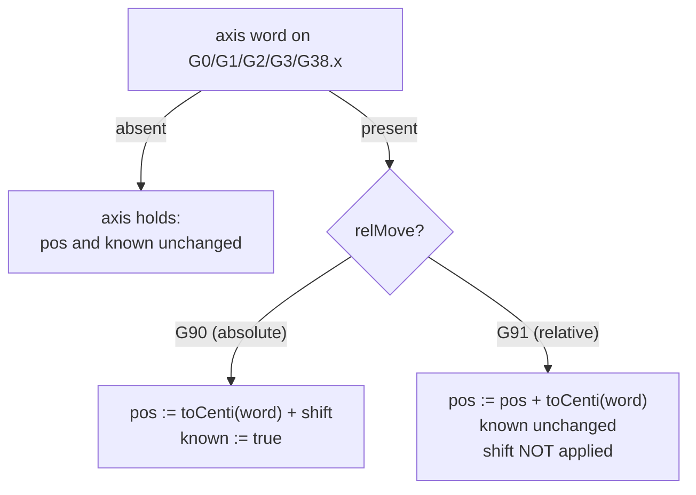
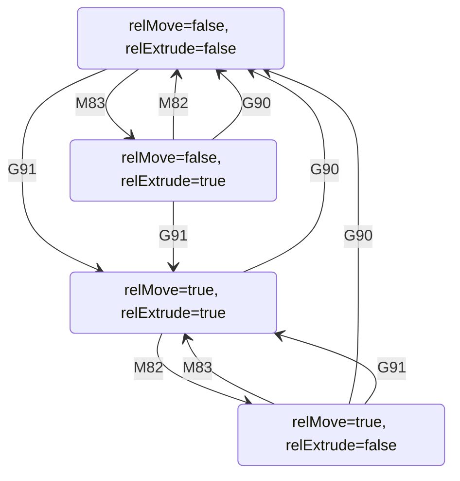
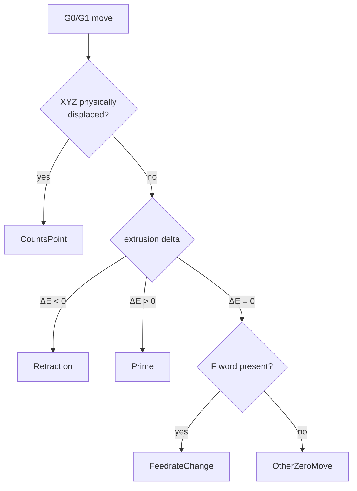

# printer-core.qnt — the from-scratch printer-state semantics

Companion to `lib/printer-core.qnt` (modules `printer_core_next`,
`printer_core_next_test`, `printer_core_next_props`).

This file belongs to the **quint-next** bank: the normative, spec-first
redesign of gcode-preview's semantics. It answers "what would work better if we
designed it from scratch", not "what does the code do today". Where it differs
from the current implementation, the difference is intentional and listed in
the Divergence ledger below.

## What it specifies

One pure module holds the whole printer-state semantics: a `PrinterState`
record, a `Command` sum type covering G0/G1, G2/G3, G20/G21, G90/G91, G28,
G38.2–G38.5, G92, G92.1, M82/M83 and T0–T7, and one transition function
`applyCommand`. Every quint-next machine that interprets position or extrusion
G-codes folds this function and may not re-transcribe a command's effect.

The design makes three property families true by construction, and checks them
as invariants in `printer_core_next_props`:

**Mode independence.** A physical endpoint is expressible in G90 or G91, in mm
or inches, with the same resulting state. Relative deltas are frame-free: the
G92 workspace shift cancels out of them, so it is never applied to a relative
word. Checked by `moveLawX/Y/Z/E`.

**Partial homing.** Axis knowledge is per-axis and monotone; G28 homes exactly
the named axes. Checked by `partialHomeLaw` and `knowledgeMonotone`.

**Physical stats naming.** A retraction is a stationary-carriage move whose
extrusion delta is negative; a prime is one whose delta is positive — in either
E mode. Checked by `statsPhysical`.

Firmware citations were verified against marlinfw.org on 2026-11-14 (G028,
G038, G090, G091, G092, M083) and the RepRap wiki G-code page. Each `Command`
variant carries its own Authority / Design stance / Exclusions block.

## Mermaid diagrams

How a single axis word on a move resolves:

The two mode flags and the commands that may touch them (last writer wins —
Marlin M083: "G90 and G91 clear this mode"):

Classification of a zero-or-more-word linear move, by physics:

## Decisions and reasoning

### G90/G91 designed in

**Decision.** `relMove: bool` is part of the state. A relative axis word adds
its scaled value to the current physical position, without the workspace shift
and without minting knowledge. G90/G91 also reset the E mode; M82/M83 override
it afterwards (last writer wins).

**Reasoning.** Marlin documents G91 as "all coordinates are interpreted as
relative to the last position" and both pages state the mode "includes the
extruder position unless overridden" by M83/M82; the M83 Notes add "G90 and G91
clear this mode". The shift cancels algebraically out of a delta (physical =
logical + shift at both ends), so relative moves compose with G92 for free —
that is what makes mode independence a construction rather than a test.
Knowledge stays absolute-evidence-only: a delta from an unknown position is
still unknown.

**Alternatives considered.** Marlin's internal formula (`relative E =
relative_mode OR axis_relative_modes[E]`) makes M82 unable to exit relative E
while G91 is active, which contradicts Marlin's own documentation pages; the
documented last-writer-wins reading was chosen (charter P1 prefers documented
semantics). Per-axis relative flags were rejected as out of scope.

**What the main bank pins.** G90/G91 are unregistered no-ops; there is exactly
one positioning mode (pinned in `quint/lib/printer-core.qnt`).

### G28 honors axis words

**Decision.** `G28 X` homes only X; the bare form homes all three. A homed axis
is known at the physical origin. Un-named axes keep both their position and
their knowledge state; shift, E, modes and tool survive homing. "Homed" as a
whole-machine notion is the derived `fullyHomed`, not stored state.

**Reasoning.** Marlin G028: "The default behavior with no parameters is to home
all axes" and "G28 X Z ; Home the X and Z axes". Per-axis knowledge makes
partial homing representable and gives the bank a monotone, checkable
invariant instead of a global flag that over-claims.

**Alternatives considered.** Keeping a global `homed` flag alongside per-axis
knowledge (redundant, and wrong under partial homing). Modeling G28 O
(trusted-position skip) — excluded as endstop hardware territory.

**What the main bank pins.** Axis words are ignored; G28 always homes all three
axes and sets one global `homed` flag (a pinned divergence).

### Physically-named extrusion classification

**Decision.** `classifyLinear` is state-aware. Displacement decides
`CountsPoint`; on a stationary carriage the signed physical extrusion delta
decides: negative is `Retraction`, positive is `Prime`; zero delta falls to
`FeedrateChange` on an F word, else `OtherZeroMove`.

**Reasoning.** The names then mean what a printer does: a retraction pulls
filament back in M83 (`G1 E-2`) and in M82 (an E word below the current
position) alike. The classification is a pure function of the same transition
semantics, so it can never disagree with the state change it describes
(`statsPhysical` checks exactly that).

**Alternatives considered.** Keeping raw-word-sign classification with renamed
constructors — rejected because it still misclassifies absolute-mode primes and
relative-mode retractions. Keeping axis-word presence as the `CountsPoint`
trigger — rejected: a move to the position the carriage already occupies is
physically zero-length, and with G91 in the alphabet "has an axis word" no
longer approximates "moves".

**What the main bank pins.** On moves without axis words, the raw E-word sign
decides, with positive raw E counted as retraction and negative as deretraction
(`src/job-stats.ts`; pinned in the main bank as `classifyLinear`); any
axis-word presence counts a path point.

### Probes: z-clamp dropped

**Decision.** The probe family is the Marlin-documented G38.2–G38.5 quartet.
A probe's target resolves exactly like a linear move's (modes, units, shift);
the terminal position is the commanded target; E is never touched; a probe
without axis words is a no-op. The z-clamp is dropped, and G31 is dropped from
the family.

**Reasoning.** Marlin G038 documents target coordinates and an error "if it
reaches the target position" without triggering — reaching the target is the
only terminal position the firmware defines statically. Where the probe
actually stops on contact depends on hardware the model cannot know; inventing
a trigger plane at physical Z0 bakes in physics that is wrong for any surface
not at Z0 and breaks move-law uniformity. With the clamp gone, probes satisfy
the same move laws as G0/G1, so mode independence covers them for free.

**Alternatives considered.** Keeping the clamp as a "bed plane" approximation —
rejected as library-invented physics with no firmware authority (its stance in
the main bank). Modeling a nondeterministic trigger point between start and
target — attractive but it makes every downstream machine nondeterministic;
left as an open item. G31: Marlin's G31 is Dock Sled and RepRapFirmware's is
probe configuration — too dialect-ambiguous to carry in a normative design.

**What the main bank pins.** G31 and G38.2–G38.5 all probe; a shifted Z target
below the origin plane, from a known Z at or above it, clamps to physical Z0
(library-invented, pinned in the main bank). A P word makes the command a
no-op.

### G92 / G92.1: kept

**Decision.** KEPT as-is from the current implementation. Word form: `shift :=
physical − scaled word` per axis, no motion, no knowledge change; E words set
the extruder position directly; the bare form resets (`shift := physical`,
`E := 0`); G92.1 clears the shift. G92 words are logical positions even under
G91 (G92 is modeless).

**Reasoning.** The positionShift offset model conforms to Marlin's
position_shift workspace offset (Marlin G092; "New extruder position" for E),
and the bare-form reset follows the RepRap-wiki dialect. Conformant designs
are kept (charter P1); the `g92Law` invariant checks the readback equation
`physical − shift = word` on every worded axis.

**What the main bank pins.** The same — this is the ledger's non-row, cited as
a kept design.

### Other kept and retained choices

Arc endpoints and E accounting behave exactly like linear moves, with I/J/R
carried but never touching printer state (conforms; I/J are always relative
offsets). Units convert at read time through `scale_next.toCenti` and stored
state never rescales (conforms). Tool selection records an index and nothing
else (conforms). F words are carried but never unit-converted or stored — a
retained divergence from Marlin's G20 F conversion, with the stated reason
that feedrate has no semantic role in this model beyond presence in the
zero-move classification.

## Divergence ledger

| Aspect | Current implementation | From-scratch design | Why the design works better |
| --- | --- | --- | --- |
| G90/G91 | Unregistered no-ops; one absolute positioning mode | `relMove` flag; relative words add scaled deltas to physical position, shift-free, knowledge unchanged | Matches Marlin G090/G091; slicer G91 sequences (wipes, park moves) get correct semantics; mode independence holds by construction (`moveLawX/Y/Z`) |
| G90/G91 ↔ E mode | n/a (G90/G91 not registered) | G90/G91 also set the E mode; M82/M83 override later (last writer wins) | Marlin-documented coupling ("G90 and G91 clear this mode"); no hidden mode after a G91 |
| G28 axis words | Ignored; G28 always homes all three axes | Only named axes home; bare form homes all | Marlin-documented; partial homing cannot silently teleport un-named axes |
| Homed state | One global `homed` flag | Per-axis `known`; `fullyHomed` derived | Partial homing is representable; knowledge is monotone and checkable per axis |
| Zero-move stats | Raw E-word sign on moves without axis words; positive raw E counted as retraction, negative as deretraction | Physical extrusion delta on zero-displacement moves; negative delta = `Retraction`, positive = `Prime` | Names match filament physics in both E modes; classification provably agrees with the state transition (`statsPhysical`) |
| Path-point trigger | Any axis-word presence counts a path point | Physical XYZ displacement counts a path point | `G1 X<current>` and relative `G1 X0` are physically zero-length; with G91 modeled, word presence no longer approximates motion |
| Probe z-clamp | Below-origin shifted Z targets from a known Z ≥ 0 clamp to physical Z0 | Dropped; probes travel to the commanded target (Marlin's documented no-trigger terminal position) | No invented physics; probes obey the same move laws as G0/G1, so every mode/shift/units property covers them |
| Probe family | G31 and G38.2–G38.5; P word makes the command a no-op | G38.2–G38.5 only; no P word; no-axis-word probes are no-ops | G31 is dialect-ambiguous (Marlin: Dock Sled; RRF: probe config); the design carries only firmware-documented probe targets |

Stated neutrally: the "current implementation" column describes pinned
decisions of the shipping library as recorded in the main bank's authority
annotations; it files no defects.

## Unbound by design

This bank has no vitest replay and no trace corpus, deliberately. Every ledger
row above would fail a replay against the current code — that is the point of
a normative design bank. The gate is internal consistency instead:
`npx quint parse`, `npx quint test` (15 runs across the two files), and
`npx quint run --invariant allInvariants --max-samples 200 --max-steps 30
--seed=0x67c0de2026` on `printer_core_next_props` all pass.

One deviation from the main bank's style sheet is deliberate:
`printer_core_next_props` is a runnable machine living in a `lib/` file. It
validates the library itself (like the sibling test module) and exists so the
designed-in properties are checked invariants rather than prose; spec machines
proper live at the bank root.

## Open items

Whether arcs should feed the stats classification (they are currently excluded,
matching the main bank's pinned no-count decision) is OPEN; if they do, the
physical-displacement rule extends to them unchanged.

A nondeterministic probe trigger point (stop anywhere between start and
target) is OPEN; it would model G38 contact honestly at the cost of
determinism downstream.

M206/M428 home offsets are reserved naming (see the G92 work on PR #436) and
not modeled. G92.2/G92.3, per-extruder E modes, G28 O, software endstops and
fractional words remain out of model.

Streaming refinement is a designed-in property of this bank (charter P2) but
is owned by the streaming machine at the bank root, not by this library; until
that machine lands, the claim is OPEN here.
