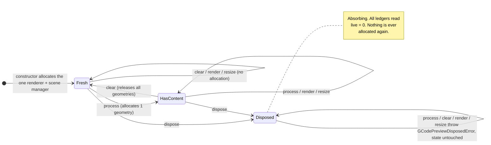
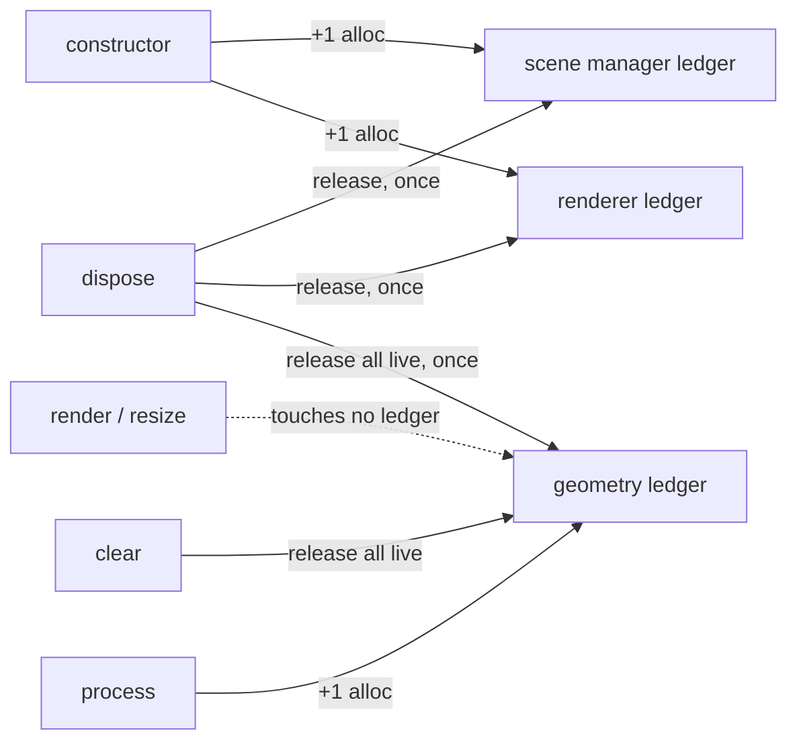

# lifecycle_next — the from-scratch public-API lifecycle

Companion to `lifecycle.qnt` (module `lifecycle_next`), part of the normative `quint-next` bank. This spec answers one question: if the GCodePreview lifecycle were designed spec-first, what would construct, process, clear, render, resize and dispose promise?

It is a design artifact. Where it differs from the current implementation, the difference is intentional and recorded in the Divergence ledger below.

## What it specifies

The machine models one preview object from construction to end of life. Its state is an observable phase (`Fresh`, `HasContent`, `Disposed`), a path count, and an explicit resource ledger: `alloc`/`released` counters for three resource classes — the WebGL renderer, the scene manager, and geometry batches.

Every public call is a single pure transition (`applyOp`) that returns both the next state and a designed outcome: a normal return, or a thrown `GCodePreviewDisposedError`. Ghost state (`ghostPre`, a full pre-step snapshot, plus `ghostLast` and `ghostEverDisposed`) turns the API laws into invariants rather than anecdotes:

`Disposed` is absorbing. dispose releases every live resource of every class exactly once; a second dispose is a documented no-op; every other call on a disposed preview throws and mutates nothing. There is no resurrection path: the design allocates exactly one renderer and one scene manager per preview lifetime, so `rend.alloc == 1` is an invariant, not a hope.

render and resize never allocate. process is the only geometry allocator; clear and dispose are the only releasers. clear and dispose are idempotent, each checked as a snapshot-equality invariant over ghost history.

## Phase machine

## Resource ledger flow

Each class tracks `alloc` and `released`; `live` is their difference. The diagram shows who may move which counter.

## Decisions and reasoning

### Use-after-dispose throws; double dispose is a no-op

**Decision.** After dispose, `process`, `clear`, `render` and `resize` throw a descriptive `GCodePreviewDisposedError` without mutating anything (strong exception guarantee, checked by `rejectionIsPure`). `dispose` itself remains callable forever and does nothing the second time (`disposeIdempotent`).

**Reasoning.** Teardown code lives in `finally` blocks and framework cleanup effects, which may run more than once; an idempotent dispose keeps those paths safe, matching the TC39 Explicit Resource Management design (`DisposableStack.dispose()` is idempotent) and the .NET `IDisposable` convention. Every other call on a disposed object is a program bug, and throwing surfaces it at the call site — the same split TC39 makes (`use()` on a disposed stack throws `ReferenceError`) and .NET makes (`ObjectDisposedException`).

**Alternatives considered.** Documented no-op for all calls: silent, but hides real bugs (a view that stops updating with no signal). Throw on double dispose too: punishes safe teardown patterns for no leak-safety gain. Lazy resurrection: see the ledger — it makes leak analysis non-local.

**What the main bank pins.** No lifecycle call ever throws. `dispose()` nulls the internal scene manager and any later call reaches the lazy `sceneManager` getter, which silently constructs a fresh `SceneManager` (and with it a fresh `WebGLRenderer`).

### The ledger lives in the state

**Decision.** `alloc`/`released` counters per resource class are part of the specified state, with conservation (`released <= alloc`), singleton bounds (`live(rend) <= 1`, and in fact `rend.alloc == 1`), `Disposed implies zero live`, monotone counters, and a releaser restriction (only clear/dispose release geometries, only dispose releases the render side).

**Reasoning.** "Dispose releases everything exactly once" is only checkable if allocation and release are observable. Making the ledger part of the contract means a conforming implementation must expose (at least in debug builds) the counts the invariants mention, which turns leak hunting into reading two integers.

**Alternatives considered.** A boolean `disposed` flag alone: cannot express exactly-once release or the no-resurrection law. Tracking individual resource identities: more faithful, but counters already distinguish every bug class the identities would, at a fraction of the state space.

**What the main bank pins.** `SceneManager` keeps a private `disposables` array; dispose walks it. Nothing counts allocations, and exactly-once release is not observable from outside.

### render never allocates; process builds eagerly

**Decision.** Geometry is built when content arrives (process), never when it is drawn. `renderNeverAllocates` checks that render and resize move no `alloc` counter; `processContract` checks process allocates exactly one geometry per call.

**Reasoning.** render is the call that ends up inside `requestAnimationFrame` loops; an allocation-free render is the difference between a steady frame time and GC churn. Separating build from draw also makes the purity law machine-checkable at all — a "mostly doesn't allocate" render cannot be an invariant.

**Alternatives considered.** Build-on-render with caching: same steady-state behavior but the first frame after every change pays the build, and the law degrades to a conditional. Letting clear re-render (current behavior): couples a release-only operation to the draw path.

**What the main bank pins.** `render()` performs a full scene rebuild, and `clear()` calls `sceneManager.clear()` followed by `sceneManager.render()`, so both can allocate and both resurrect a disposed preview.

### dispose releases the job too

**Decision.** After dispose, `paths == 0`: the parsed job is released along with the render side.

**Reasoning.** In an absorbing design the retained job is unreachable — every call that could show it throws — so keeping it is a pure leak. Releasing it makes `disposedReleasesAll` one uniform statement over every class.

**What the main bank pins.** The job and parser survive `dispose()`; a later call re-renders the retained content through the resurrected manager.

## Divergence ledger

| Aspect | Current implementation | From-scratch design | Why the design works better |
|---|---|---|---|
| dispose finality | `dispose()` nulls `_sceneManager`; the lazy `sceneManager` getter rebuilds a fresh `SceneManager` + `WebGLRenderer` on any later lifecycle call | `Disposed` is absorbing; `rend.alloc == 1` forever (`disposedAbsorbing`, `singletonRenderSide`) | WebGL contexts are a capped browser resource; silent resurrection makes "disposed means freed" unverifiable and can leak contexts in SPA mount/unmount cycles. Absorption makes leak-freedom a local invariant. |
| Use-after-dispose outcome | Every call succeeds; nothing ever throws | Non-dispose calls throw `GCodePreviewDisposedError` and mutate nothing (`rejectionIsPure`) | Fail-fast turns a lifecycle bug into a stack trace at the faulty call site instead of a quietly revived renderer. |
| Double dispose | `_sceneManager?.dispose()` — optional chaining makes it a de-facto no-op | Documented no-op, pinned by `disposeIdempotent` (snapshot equality) | Same observable behavior, but promised: teardown in `finally`/cleanup effects is safe by contract, not by accident of `?.`. |
| Job retention across dispose | Job and parser survive; resurrected manager re-renders old content | dispose releases the job; `Disposed implies paths == 0` | Retained-but-unreachable state is a leak; releasing it makes "dispose implies zero live resources" one uniform law. |
| render allocation | `render()` rebuilds the scene (allocates); `clear()` also calls `render()` | render/resize touch no ledger (`renderNeverAllocates`); process is the only allocator; clear releases only | Allocation-free render is a checkable performance law and keeps rAF loops GC-quiet; clear becomes a pure release operation. |
| Resource accounting | Private `disposables` array, no observable counts | Explicit `alloc`/`released` ledgers with conservation, monotonicity and releaser restrictions | Exactly-once release and at-most-one-live-renderer become invariants an implementation can expose and a test can read. |
| clear on a disposed preview | Resurrects the manager and lands in `fresh` | Throws, like every non-dispose call | One rule for the whole disposed surface; no special case to document. |

Current behavior read from `src/gcode-preview.ts` (constructor, `clear`, `processGCode`, `dispose`, the lazy `sceneManager` getter) and `src/scene-manager.ts` (`dispose`, `resize`, render paths), plus the pinned description in `verification/quint/lifecycle.qnt` / `lifecycle.md`. Stated neutrally; the main bank pins it as the implementation's actual contract today.

## No replay binding, by design

This bank has no vitest replay and no trace corpus. The point of `lifecycle_next` is precisely the behaviors the implementation does not have — absorption, throwing, the ledger — so any replay would fail by construction (charter P6). The gate is internal consistency:

`npx quint parse`, `npx quint test`, and `npx quint run --invariant allInvariants --max-samples 200 --max-steps 30 --seed=0x67c0de2026` all pass on `verification/quint-next/lifecycle.qnt` (5 runs green; no violation found at 31-step traces).

## Open items

**Eventual release is OPEN.** "Every allocation is eventually released" is a liveness claim needing fairness (an eventual dispose) that the simulator does not force. The checked approximations are `ledgersConserve` (released or still live, exactly) and `disposedReleasesAll` (dispose releases everything). A temporal `eventually` formula would need a quint `temporal` check with a fairness assumption on `Dispose`.

**Granularity.** One geometry batch per process call abstracts real builds (many geometries per job). Counters scale linearly, so the laws transfer, but a finer model could distinguish per-layer batches and partial clears.

**Out of model.** Parse errors and rejected G-code, the streaming entry points (`processGCodeStream`, in-flight chunks racing `clear`/`dispose`), rAF/timeout teardown detail, and DOM/canvas ownership. The streaming race deserves its own `_next` machine; RL-1's "no rAF fires after dispose" clause belongs there too.

**Error surface.** The design pins one error name. Whether it should be a class hierarchy (e.g. distinguishing disposed from not-yet-initialized in a future async-init design) is undecided.
