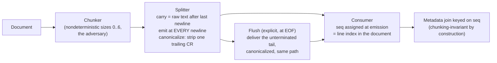
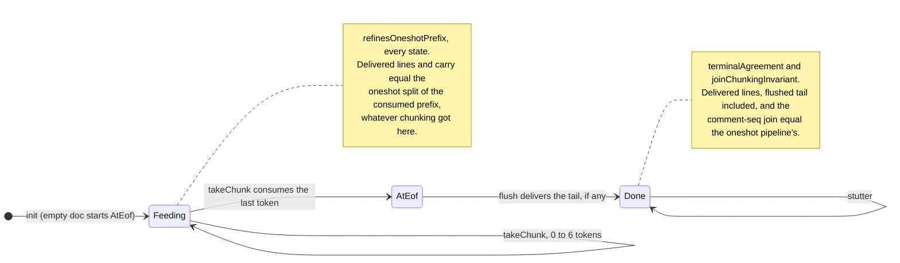

# Streaming ingestion, designed from scratch

A companion to `streaming.qnt` (module `streaming_next`). This is a NORMATIVE design artifact of the quint-next bank: where it differs from the current implementation, the difference is intentional and recorded in the divergence ledger below. It is independent of the printer core — its whole universe is text, chunks, lines and sequence numbers.

## What it specifies

A G-code document arrives as arbitrarily sized chunks, and chunk boundaries can fall anywhere: mid-line, between the `\r` and `\n` of a CRLF pair, or around an empty read. The design's one organizing idea is that the splitter's state is nothing but the raw text after the last `\n` it has consumed. Everything else follows from that.

Every completed line is emitted the moment its `\n` arrives. Emission canonicalizes the line once, by stripping exactly one trailing `\r`, so LF and CRLF files become indistinguishable from that point on. End of stream is an explicit flush step that delivers the final unterminated line through the same path. Each delivered line carries a sequence number assigned at emission, equal to its line index in the whole document — the join key for all downstream metadata.

Because the splitter's output is a pure function of the consumed prefix, any chunking refines the oneshot result at every layer, by construction. The spec does not take that on faith: `refinesOneshotPrefix` checks it in every reachable state, over every document and chunking the simulator explores.

The document is a list of integer tokens: `0 → 'a'`, `1 → 'b'`, `2 → ' '`, `3 → ';'`, `4 → '\n'`, `5 → '\r'`.

## The pipeline

## The lifecycle

The flush is a real lifecycle state, not driver cleanup: `AtEof` is entered exactly when the cursor reaches the end, `flush` is the only action enabled there, and every transition out of it lands in the absorbing `Done`. The phases are a sum type pinned to the cursor by `phaseConsistent`, and the cursor's monotonicity is checked by `cursorMonotone`.

## Decisions and reasoning

### CRLF is normalized at the splitter

**Decision.** A completed line is canonicalized at emission by stripping exactly one trailing `\r`. A lone `\r` anywhere else is data. The flush canonicalizes the tail the same way.

**Reasoning.** The RepRap wiki's G-code page (Introduction) states the accepted endings: "G-code line endings are Unix Line Endings (`\n`), but will accept Windows Line Endings (`\r\n`)". Normalizing at the splitter makes those two endings indistinguishable to every downstream layer — comment classification, metadata patterns, any kept-lines archive — at one single point. The chunk-boundary case needs no lookahead: a chunk ending in `\r` just leaves the `\r` waiting in the raw carry, and the strip happens when the `\n` arrives (`crlfAcrossChunkBoundaryTest`).

**Alternatives considered.** Treating a lone `\r` as a terminator too, as Marlin's serial reader does (Marlin 2.1.x `src/core/macros.h`: `#define ISEOL(C) ((C) == '\n' || (C) == '\r')`). Rejected with reason, per charter P1: under that rule every CRLF is two terminators unless pairing lookahead spans chunk boundaries, and the files a viewer ingests are slicer output in the two RepRap-named endings, not a serial byte stream. Also rejected: normalizing in the parser (the current approach — see the ledger), which leaves every other consumer of lines to handle `\r` itself.

**What the main bank pins.** The splitter passes `\r` through inside the line; `parseCommand`'s `trim()` removes it at parse time; lines kept via `keepLines` retain it.

### No content-dependent holdback; metadata joins on sequence numbers

**Decision.** The splitter is content-agnostic: it never inspects a line to decide whether to emit it. Each delivered line carries `seq`, assigned at emission and equal to its index in the document. The consumer layer's join (modeled as the set of comment-only line seqs) keys on `seq`.

**Reasoning.** The current holdback of trailing comment-only runs exists so that chunk-local metadata parsing sees a slicer's layer-description block together with the line that follows it. Once lines carry a document-global `seq`, joining metadata to lines no longer depends on which lines arrived in the same batch — `joinChunkingInvariant` states it, and the invariant holds by construction because `seq` is a function of the document alone. The holdback's job disappears, and with it its costs: the carry shrinks from an unbounded comment run to at most one line (`carryIsOneLine`), and delivery latency stops depending on content.

**Alternatives considered.** Keeping the holdback alongside seq numbers: pure cost, no remaining benefit. Buffering whole layers downstream instead: that is a consumer concern, and the consumer can do it by seq ranges without the splitter's help.

**What the main bank pins.** `splitChunk` holds back the maximal trailing run of comment-only lines (terminating newline kept) until a non-comment line closes it; the `Parser` then rebuilds whole-file line indices from `lineCount` offset arithmetic per chunk.

### The flush is an explicit step that delivers the final partial line

**Decision.** End of stream is a modeled transition: `AtEof --flush--> Done`. A nonempty carry is delivered as a line — canonicalized, sequence-numbered, classified — through exactly the same consumer path as every other line. An empty carry flushes nothing, so a `\n`-terminated document gains no phantom final empty line.

**Reasoning.** Marlin's SD reader treats end-of-file as a line terminator (Marlin 2.1.x `src/gcode/queue.cpp`, `get_sdcard_commands`: "End of file with no newline"), so the design's EOF-terminates-the-last-line is the firmware baseline. Making it one step with one delivery path means `terminalAgreement` can include the tail, and nothing about the last line (its seq, its metadata classification) is special-cased. This is charter P3: the lifecycle is part of the spec with designed, checkable outcomes.

**Alternatives considered.** Leaving the flush to the stream driver outside the splitter contract (the current shape): then the tail bypasses whatever the per-line path does, and the bypass must be re-audited every time that path grows a responsibility — which is exactly how the current tail-flush came to skip metadata forwarding.

**What the main bank pins.** `readStream` flushes a nonempty tail in a separate parse call after its loop; that call destructures only `commands`, so metadata parsed from the tail is not forwarded to `job.metadata`, and `onStreamEnd` fires afterwards.

### Refinement is a per-state invariant, not a terminal check

**Decision.** The headline theorem `refinesOneshotPrefix` holds in every reachable state: delivered lines and carry equal the oneshot split of exactly the consumed prefix. `terminalAgreement` (with the flushed tail) and `prefixOfOneshot` are its corollaries, stated and checked separately.

**Reasoning.** Per-state refinement is strictly stronger than terminal confluence: it implies that any two chunkings agree at every shared cursor position, so chunk boundaries are unobservable downstream at all times, not just at the end. It is also the exact statement of the design idea — the splitter's state is a function of the consumed prefix — so a transcription error anywhere in `applyChunk` breaks it immediately rather than only at exhaustion.

**Alternatives considered.** Terminal-only confluence (the main bank's `terminalConfluence`): weaker, and vacuous for any sampled run that does not exhaust its document. A two-machine product invariant comparing two live chunkings: subsumed by prefix-refinement, since both sides equal the same oneshot prefix; kept as a deterministic run instead (`twoChunkingsAgreeTest`).

**What the main bank pins.** Its `streaming.qnt` checks `prefixOfOneshot` per state and full agreement only at exhaustion, because the current splitter's comment holdback makes mid-stream output depend on where chunks fell — per-state refinement is false for it. That falsity is the measure of what this design buys.

### Interior empty lines are delivered, with their sequence numbers

**Decision.** An empty line (two adjacent separators) is delivered like any other line.

**Reasoning.** `seq` must equal the file line index to be a join key, so no delivered line may be skipped. Conservation also stays exact: raw segments, each re-terminated, reconstruct the document to the token (`conservation`, over the `ghostRaw` ghost).

**Alternatives considered.** Discarding empty lines as Marlin's queue does (`queue.cpp`, `process_line_done`): right for a motion queue, wrong for a viewer that must map metadata back to file positions. Stated divergence from firmware, with this reason, per charter P1.

**What the main bank pins.** The splitter never produces them separately (lines travel joined), and `readStream` skips empty `complete` strings precisely because parsing `''` would miscount lines — the phantom-line hazard this design removes by never re-joining lines into a string.

### Unbound by design: no replay, no traces

**Decision.** This spec has no vitest replay and no ITF trace corpus. Its gate is internal consistency: `npx quint parse`, `npx quint test --main streaming_next`, and `npx quint run --main streaming_next --invariant allInvariants --max-samples 200 --max-steps 30 --seed=0x67c0de2026` (all against `verification/quint-next/streaming.qnt`) must pass, and all three do.

**Reasoning.** A replay against the current code would fail on purpose — immediate emission vs last-newline batching, no holdback, CRLF stripping, flush-in-contract are all designed divergences. Binding the spec to the implementation would turn every intended difference into a red test. The main bank already pins current behavior with replays; this bank answers a different question (charter P6).

**Alternatives considered.** Replaying only the invariant-compatible observables (cursor, conservation): a partial binding would blur which bank is normative for what.

**What the main bank pins.** Its `streaming.qnt` ships 40 ITF traces replayed against the real `splitChunk` in `src/__tests__/split-chunk.ts` — the correct arrangement for a pinning bank, and the wrong one for this one.

### Corpus sized so the terminal invariants are exercised

**Decision.** Random documents are 56–72 tokens from a bag weighted toward `\n` (2/8), `;` (2/8) and `\r` (1/8); chunks are uniform 0–6 tokens; the gate runs 30 steps.

**Reasoning.** Chunks average 3 tokens, so a typical run consumes its document in about 22 steps, flushes, and stutters briefly — most sampled runs reach `Done`, so `terminalAgreement` and `joinChunkingInvariant` are checked non-vacuously. Verified by probe: negating `s.phase == Done` (and separately, a tail-delivering flush event) under the gate seed finds a witness in the first sampled trace. Degenerate documents (empty, newline-free, CR-heavy) live in the deterministic `*Test` runs.

**Alternatives considered.** Longer documents stress the splitter more per run but starve the terminal invariants under a 30-step budget.

**What the main bank pins.** 100–120 tokens under a 40-step trace budget, tuned for trace-corpus coverage metrics this bank does not have.

## Divergence ledger

| Aspect | Current implementation | From-scratch design | Why the design works better |
| --- | --- | --- | --- |
| Emission granularity | `splitChunk` splits at the chunk's last `\n` and returns one joined `complete` string; `readStream` skips `complete === ''` because parsing it would count a phantom line | Every `\n` completes a line immediately; output is a list of lines, possibly empty | One line per consumed separator holds by construction; no empty-string sentinel, no re-split of joined text, no phantom-line special case |
| Comment-run holdback | A trailing run of comment-only lines is held in the tail (terminating `\n` kept) until a non-comment line closes it; the tail is unbounded in the run's length | No content-dependent holdback; the splitter never inspects line content | Carry is bounded by one line (`carryIsOneLine`); delivery latency is content-independent; per-state refinement becomes true, not just terminal confluence |
| CRLF policy | `\r` travels inside the line; `parseCommand`'s `trim()` removes it at parse time; `keepLines` archives retain it | The splitter strips exactly one trailing `\r` at emission (and at flush); every downstream layer sees canonical lines | One normalization point instead of per-consumer handling; LF and CRLF files are indistinguishable from the splitter on; chunk-split CRLF needs no lookahead (the pending `\r` waits in the carry) |
| End-of-stream tail | `readStream` parses a nonempty leftover tail in a separate call after its loop; that call forwards only `commands`, so tail metadata is not assigned to `job.metadata` | An explicit `flush` step delivers the final partial line through the same sequence-numbered consumer path | Terminal agreement including the tail is a checked invariant; one delivery path means the last line's seq and metadata are handled like every other line's |
| Line numbering and metadata join | The `Parser` rebuilds whole-file `lineIndex` from `lineCount`/`lineOffset` arithmetic per chunk, plus positional `layerIndex` renumbering | `seq` is assigned at the splitter at emission and equals the document line index; joins key on `seq` | The join is chunking-invariant by construction (`seqMatchesIndex`, `joinChunkingInvariant`); the per-chunk offset arithmetic — the habitat of the lineCount off-by-one bug class — does not exist |
| Trailing-newline accounting | Oneshot `parseGCode("a\n")` splits to two lines (the last empty), while the streamed path delivers one line and flushes nothing, so the two paths count lines differently | A `\n`-terminated document produces no final empty line in either path; the oneshot ghost is defined as chunked-plus-flush output | Streamed and oneshot agree on line counts by definition; EOF terminating an unterminated final line matches Marlin's SD reader |

## Open items

`quint verify` has not been run — no JVM on this machine. The `oneOf` over `setOfMaps(0.to(71), …)` in `init` and the unbounded lists (`doc`, `ghostRaw`, `delivered`) are the constructs most likely to need rework for an Apalache lane.

Pairwise agreement between two live chunkings is implied by `refinesOneshotPrefix` (both equal the same oneshot prefix) and demonstrated deterministically in `twoChunkingsAgreeTest`, but is not stated as a two-machine product invariant.

The consumer layer models the metadata join as comment-line classification only. The full join — slicer detection latch, thumbnails spanning lines, layer field blocks — is a separate machine over sequence-numbered lines and is not yet specified in this bank; its design precondition (joins key on `seq`) is what this spec establishes.

Out of model, deliberately: byte decoding and UTF-8 chunk boundaries (upstream of the splitter), tabs and non-space blanks in comment classification (the model's one blank is `' '`; a `\r` before `;` classifies as non-comment here, where the current `trimStart()` would skip it), lone-CR (classic Mac) line endings as terminators (stated divergence from Marlin's serial `ISEOL`, reason in the CRLF decision), and transport failure (reordering, loss, backpressure).
