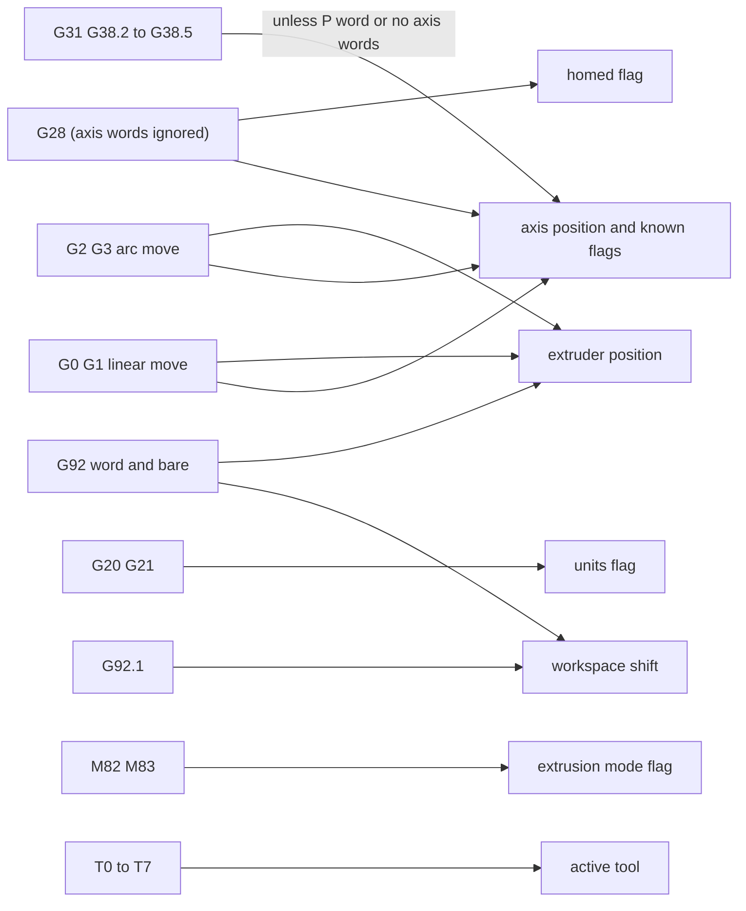
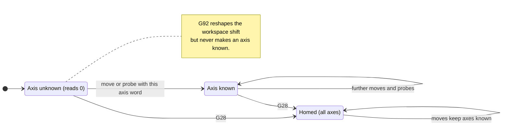

# printer_core — the shared printer semantics, at a glance

A companion to `printer-core.qnt`, the single printer-state semantics behind every v2 machine that interprets position and extrusion G-codes. It is a library module: one record type, one command sum type, one pure transition function, and no state of its own.

## What it models

The printer-state effects of G0/G1 linear moves, G2/G3 arc endpoints, G20/G21 units, G28 homing, G31/G38.2–G38.5 probes with the z-clamp rule, G92 in word and bare forms, G92.1, M82/M83 extrusion modes and T0–T7 tool selection — as `pure def applyCommand(s: PrinterState, c: Command): PrinterState`.

`PrinterState` holds per-axis known/position pairs in centi-mm, the extruder position, the G92 workspace shift, the extrusion-mode and units flags, the homed flag and the active tool. Lengths come from `lib/scale.qnt`. XYZ addressing is always absolute: G90/G91 are unregistered no-ops in the modeled library, so one positioning mode exists — a pinned decision recorded once, here.

Alongside the transition, the module exports the statistics classification (`classifyLinear`: point vs retraction vs deretraction vs feedrate change vs other), the probe-motion predicate (`probeActs`) and the canonical event tag derivation (`cmdTag`), so every machine counts and labels the same way.

## What each command class touches

Move targets always pass through the current units factor and the workspace shift. A bare G92 captures the current physical position as the shift and zeroes the extruder; G92.1 clears the shift and touches nothing else. A probe whose shifted Z target is below the origin plane, starting from a known Z at or above it, stops at physical Z0.

## Axis knowledge

Each axis starts unknown and reads zero; the first command that addresses it makes it known. G28 makes all three known at once, regardless of which axis words appear on the line.

The claims the diagram makes over time — an unknown axis always reads zero, homed implies all axes known, nothing un-homes — are not checked in this module, which has no state or invariants. Each importing machine must carry them as invariants over its own `s`; until the first machine lands they are tagged OPEN.

## Decisions and reasoning

### One semantics module instead of per-spec transcriptions

**Decision.** Every machine that interprets these G-codes imports `printer_core` and folds `applyCommand`; no spec may re-transcribe a command's state effect.

**Reasoning.** The v1 critique's central architecture finding: the printer semantics was hand-written several times — E accounting three times, the axis-update rule four times, G28/G92/M82/M83 twice each — so the flagship shift-frame equivalence theorem compared two transcriptions of the semantics rather than the semantics itself, and its headline invariant reduced to an algebraic identity of the model (a tautology no simulation could falsify). With one shared function, an equivalence machine runs both of its copies through the *same* `applyCommand` and the theorem becomes a falsifiable statement about re-encoding, not about transcription agreement. A semantic change is also one edit, not a hunt across files.

**Alternatives considered.** Keeping duplicate transcriptions with a meta-check that diffs them (rejected: the module system already solves this); one giant runnable spec containing all machines (rejected: machines need different alphabets, budgets and ghost state).

**What v1 did.** `interpreter.qnt` and `encoding-equivalence.qnt` each carried a full private copy of the semantics, with in-file copies on top (linear vs arc), and zero `import` statements existed across all seven specs.

### Record state threaded through a pure transition

**Decision.** The state is one `PrinterState` record; the transition is a pure function. Machines keep `var s` (their state record, embedding or extending `PrinterState`) and `var ev` (the trace-contract event record), and their actions reduce to recording `ev` and `s' = next(s, ...)` over pure defs.

**Reasoning.** Pure functions are importable, unit-testable (`printer_core_test` exercises every corner the v1 semantic runs pinned), composable into ghost oracles, and reusable by equivalence machines over two copies of the state. Frame bookkeeping disappears: a record update names what changes and spreads the rest.

**Alternatives considered.** Scalar `var`s with frame actions (rejected: v1 needed ~9 `keep*` actions and every command action had to enumerate them correctly; adding one field meant touching every action); nested per-concern modules with instances (deferred: plain records are simpler and Apalache-friendlier today).

**What v1 did.** 39 top-level `var`s in the interpreter spec, 8 `keep*` frame actions, and all semantics inside primed action bodies that nothing could reuse.

### Optional words as a sum type

**Decision.** `type Word = Some(int) | None`, with `match` at every consumer. Payloads are records of `Word` fields; the bare G92 is the all-`None` payload.

**Reasoning.** The `(has, word)` pair encoding needed an "absent implies 0" convention maintained by hand in every wrapper and re-proved by invariants. A sum type makes absent values unrepresentable as numbers: each consumer states explicitly what absence means for it, and the type checker discharges what well-formedness invariants used to.

**Alternatives considered.** Keeping paired booleans for ITF ergonomics (rejected in state: machines derive plain `has`/`word` fields for their `ev` record at the boundary instead — strings, ints and bools only inside `ev`, sum types everywhere else).

**What v1 did.** `(hasX: bool, wordX: int)` pairs for every word, plus generator-side `if (hx) wx else 0` normalization at every call site.

### The authority annotation scheme

**Decision.** Every `Command` variant carries a three-field block in its doc comment: **Authority** (Marlin docs / RepRap wiki / RepRapFirmware docs / none), **Library stance** (conforms / pinned-divergence / library-invented), **Exclusions** (what the model cannot express). Divergences are pinned decisions, stated neutrally.

**Reasoning.** The v1 critique found the layer never said whose semantics it encodes: a handful of ad hoc "pinned" markers coexisted with unmarked divergences (G28 axis words, F-word treatment, the bare-G92 dialect, the probe clamp) and three contradictory self-descriptions. A mandatory block per command makes the stance auditable: a replay failure on a *conforms* clause is a semantics regression; on a *pinned-divergence* or *library-invented* clause, the spec simply pins what the library does.

**Alternatives considered.** A central authority table in the README (rejected: it drifts from the variants it describes); per-line source citations (rejected: v1 deliberately removed source-path comments because they rot silently).

**What v1 did.** Roughly eight scattered "pinned" markers across 3,120 spec lines, inconsistently applied, with the largest stances (single positioning mode, G28 axis words) undocumented.

### G28 carries ignored axis-word flags

**Decision.** `Home(HomeWords)` carries the presence flags of X/Y/Z words; `applyCommand` ignores them and always homes all three axes.

**Reasoning.** The pinned decision — axis words do not restrict homing — was previously inexpressible: the alphabet had no way to emit `G28 X`, so the stance could never be exercised. Carrying the flags lets a machine generate `G28 X` traces and lets the replay observe the pinned all-axes effect against the real interpreter.

**Alternatives considered.** A bare `Home` variant (rejected: keeps the stance untestable); modeling per-axis homing (rejected: that is not what the modeled library does, and this module pins actual behavior).

**What v1 did.** `homeAll` was a bare command; the alphabet could not emit axis words on G28.

### Statistics classification lives beside the state, not in it

**Decision.** `PrinterState` holds no counters. `classifyLinear` returns a `MoveStatsKind` sum value; machines own their counters as ghost/trace state and must derive them through this one classification (arcs feed no counter; an acting probe counts one point — both pinned).

**Reasoning.** Counters are observations about a command stream, not printer state: keeping them out of the record keeps `applyCommand` a clean fold and keeps the state vector small for a future verify lane. Sharing the classification keeps the raw-E-sign rule — a zero-length move classifies by the sign of the raw E word, so in absolute mode a positive E word that lowers the extruder position still counts as a retraction — defined once.

**Alternatives considered.** Counters inside `PrinterState` (rejected: every non-move command would thread them unchanged, and equivalence machines would compare bookkeeping they do not share); classification left to each machine (rejected: that is how dialects form).

**What v1 did.** Five counter `var`s updated inline in the move action's branches, with the classification grid encoded per-branch and restated in a run test.

### The probe z-clamp is a named pure def with a library-invented stance

**Decision.** `probeTargetZ` is its own def, annotated as library-invented: a static approximation of physical probe triggering, pinned as stated.

**Reasoning.** The clamp is the one rule in this module with no firmware authority behind it; isolating and labeling it keeps the approximation auditable and gives machines a single definition to build clamp-boundary domains around.

**Alternatives considered.** Inlining the clamp into the probe branch (rejected: it buries the one library-invented rule in the middle of a match).

**What v1 did.** A `probeTargetZ` def too — the shape was right — presented without an authority marker.

## Compared vs ignored

This module has no replay of its own; machines bind it. Through their trace contracts:

| Real-system observable                                     | Replay stance                                                       |
| ---------------------------------------------------------- | -------------------------------------------------------------------- |
| X/Y/Z positions and known flags after every command        | Compared, integer-exact in centi-mm (`centiMismatch`)                 |
| Extruder position under M82/M83 across unit changes        | Compared, integer-exact                                               |
| Workspace shift effects of G92 / G92.1 / bare G92          | Compared through positions (and shift fields where machines carry them) |
| Homed flag and the all-axes effect of `G28 X`              | Compared                                                              |
| Probe z-clamp outcomes, P-word and no-axis-word no-ops     | Compared                                                              |
| Active tool index after T0–T7                              | Compared                                                              |
| Zero-length-move statistics classification                 | Compared via the machines' counters                                   |
| Arc tessellation, emitted polyline, plane selection        | Ignored — I/J/R are carried for line reconstruction only              |
| Path/geometry output, per-path dims, bounding box          | Ignored — owned by geometry machines and the ordinary suite           |
| Feedrate value storage or conversion                       | Ignored — the modeled library keeps F words out of printer state      |

## Out of model

Floats and their rounding, fractional words (`X10.25`, `X.5`), NaN and non-finite words, and malformed lines are outside the integer alphabet. Today they live in the ordinary suite: word parsing in `src/__tests__/parser/gcode-parser.ts`; per-command float behavior in `src/__tests__/interpreter/commands/` (`linear-move.ts`, `arc-move.ts`, `set-position.ts`, `set-units.ts`, `probe.ts`, `probe-g38.ts`, `home.ts`, `select-tool.ts`, `set-extrusion-mode.ts`, `reset-position-shift.ts`); NaN propagation and geometry effects in `src/__tests__/interpreter.ts`, `src/__tests__/extrusion-geometry.ts` and `src/__tests__/bounding-box.ts`; arc geometry in `src/__tests__/arc-tessellator.ts`.

Feedrate semantics beyond presence, tool offsets, homing motion, endstops and probe hardware are excluded per the variant annotations in `printer-core.qnt`.

## Open items

The shift defining equation — physical = logical + shift on every commanded axis — is stated here only as a comment on the `Shift` type. It must become a checked ghost invariant (ghost logical positions) in the interpreter machine; OPEN until that machine lands. The same goes for the axis-knowledge temporal claims above and for monotonicity of the homed flag.

Apalache-readiness: everything is annotated, pure and integer-valued. Two constructs to watch when a verify lane arrives, since `quint verify` has not been run (no JVM on this machine): `applyAll`'s `foldl` over an unbounded `List[Command]` (machines should fold step-wise rather than call it inside invariants), and heavy use of anonymous record types in variant payloads (named type aliases exist, but Apalache's quint bridge has historically been pickier about records than about scalars). Both are tagged OPEN.

`cmdTag`'s tool branch enumerates T0–T7 explicitly because Quint has no string concatenation; if the tool range ever widens, the enumeration and the machines' generators must move together. OPEN as a convention note, not a defect.
