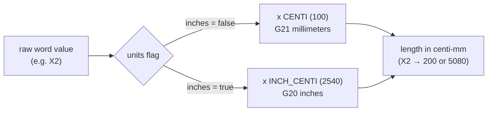

# scale — the length grid, at a glance

A companion to `scale.qnt`, the one module that owns the v2 length-scaling convention. Every other spec imports it; none restates it.

## What it models

All v2 lengths are integers in centi-millimeters: one model unit is 0.01 mm. The module defines the two scale constants (`CENTI = 100` per millimeter, `INCH_CENTI = 2540` per inch, since 1 inch = 25.4 mm) and the pure conversions from a raw G-code word to centi-mm under the active units flag.

That is the whole module. It carries no state, no commands, and no machine — it exists so the scale is written down exactly once.

## How a word becomes a length

`toCenti(word, inches)` is the single word-entry point; `lengthFactor(inches)` exposes the factor alone for specs that need it, and `mmToCenti(mm)` is the mm-only shorthand.

## Decisions and reasoning

### One module owns the scale

**Decision.** `CENTI`, `INCH_CENTI` and the conversion defs live here and nowhere else; no v2 spec may write a bare `100` or `2540` for a length.

**Reasoning.** The scale is a convention, not a fact about any one machine. When it lives in one importable module, changing it (or auditing it) is one edit, and an equivalence spec inherits units support from the same conversion its subject uses.

**Alternatives considered.** Keeping a per-spec factor definition (rejected: it re-derives the same constant and invites drift); parameterizing the grid as a module `const` (rejected for now: nothing needs a second grid, and a constant would push an instantiation obligation onto every import).

**What v1 did.** The interpreter spec had a units-aware `fac`; the encoding-equivalence spec hard-coded `* 100` at eight sites with an mm-only assumption in a comment; the layer-indexer hard-coded `* 100` at five more. Three renderings of one convention.

### Integers in centi-mm, not floats

**Decision.** The model never leaves `Int`. Words are integers; conversions multiply by integer factors.

**Reasoning.** Integer state keeps every spec Apalache-ready and makes replay comparison exact: the harness multiplies the implementation's float by 100, rounds, and requires equality (the `centiMismatch` helper in `src/__tests__/helpers/itf-replay.ts`). No epsilon is ever chosen.

**Alternatives considered.** Micro-millimeters (finer grid, same shape — nothing today needs it); modeling floats (not expressible in Quint's `Int`/`Real`-free toolchain for this purpose, and the float layer is owned by the ordinary test suite — see Out of model).

**What v1 did.** The same centi-mm convention, stated per spec rather than defined once.

### The inch factor is exact on the grid

**Decision.** `INCH_CENTI = 2540` makes whole-valued inch words exactly representable, and specs restrict inch-mode word domains to values that stay on the grid.

**Reasoning.** 25.4 mm is exactly 2540 centi-mm, so integer inch words never round. This is the property that lets inch-mode traces replay integer-exactly against an implementation that computes `word * 25.4` in floats.

**Alternatives considered.** Scaling words by 10 so tenth-inch values fit (rejected: it taxes every mm-mode domain for a case no machine currently generates).

**What v1 did.** The same `2540`, embedded in the interpreter's `fac` definition.

## Compared vs ignored

The module itself is pure, so the replay meets it only through the machines that import it. Through them:

| Real-system observable                               | Replay stance                                                   |
| ---------------------------------------------------- | --------------------------------------------------------------- |
| X/Y/Z positions after unit-scaled moves              | Compared, integer-exact in centi-mm (`centiMismatch`)            |
| Extruder position after unit-scaled E words          | Compared, integer-exact in centi-mm                              |
| The 25.4 mm/inch factor itself                       | Compared indirectly: any factor drift shifts every inch position |
| Float representation of positions inside the library | Ignored — only the rounded centi-mm value is compared            |
| Feedrate (F word) values                             | Ignored — the modeled library never converts or stores them      |
| Fractional word text (`X10.25`, `X.5`)               | Ignored — outside the integer word alphabet                      |

## Out of model

Float arithmetic, fractional words and non-finite values live outside the grid, in the ordinary test suite. The 25.4 float conversion is exercised by `src/__tests__/interpreter/commands/set-units.ts`; fractional and malformed word parsing by `src/__tests__/parser/gcode-parser.ts`; NaN and non-finite propagation through moves and geometry by `src/__tests__/interpreter.ts`, `src/__tests__/extrusion-geometry.ts` and `src/__tests__/bounding-box.ts`.

## Open items

Nothing in this module is suspected verify-hostile: it is pure `Int` arithmetic with full type annotations, which Apalache accepts. There is no JVM on this machine, so `quint verify` has not been run against it — tagged OPEN until a verify lane exists.

Inch words that do not land on the centi-mm grid (fractions finer than 0.01 in) are inexpressible here by design; machines must keep inch-mode domains on the grid. If a future machine needs finer inch values, revisiting the grid is the tracked follow-up.
