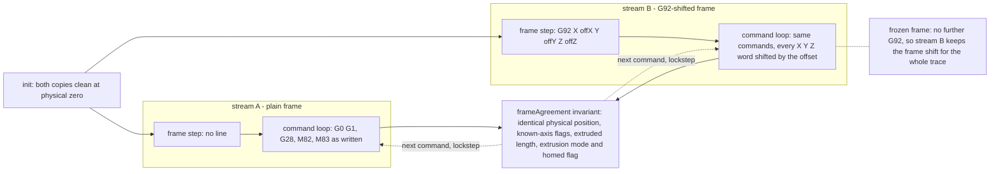
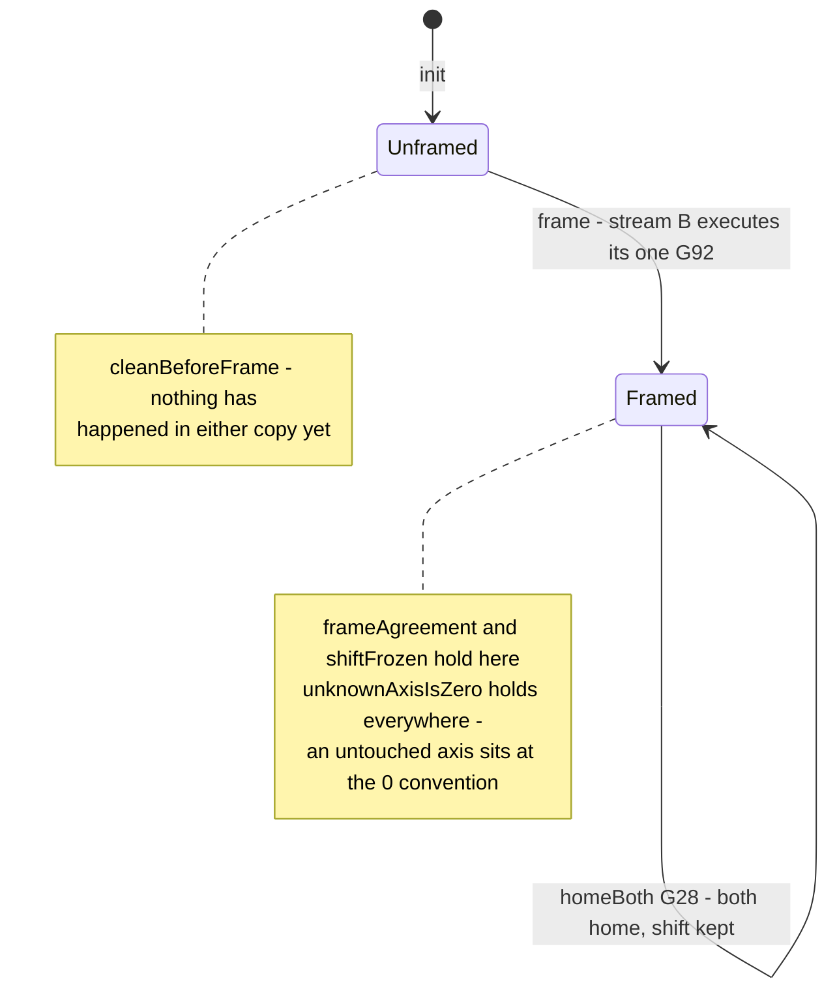

# Shift-Frame Encoding Equivalence

This spec runs two copies of the same printer in lockstep. Copy A reads a G-code program exactly as written; copy B reads the same program re-encoded into a workspace that was shifted once, up front, by a single `G92 X Y Z` — every later X, Y and Z move word carries the offset, so both machines should trace the identical physical path.

All lengths are whole centi-millimeters, E words and `G28`/`M82`/`M83` are identical in both streams, and the frame is frozen for the entire trace: no second `G92` is ever issued.

After the frame step, every step feeds one logical command to both streams at once, and the two copies must agree on every physical observable before the next command is drawn. Homing with `G28` sends both copies to the physical origin but leaves stream B's workspace shift untouched, so the frames stay apart while the physical states stay equal.

The scheduler always frames first, then draws commands at random, weighted towards moves over mode flips and homing. Each simulated trace records both command lines side by side, so it doubles as two G-code programs a replay harness can feed to two real interpreters and compare.
