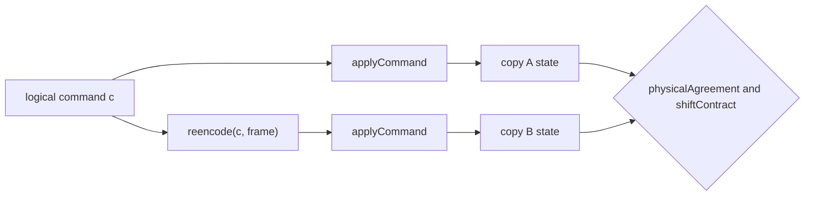
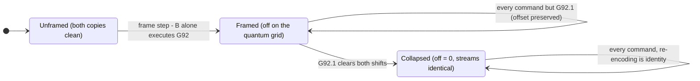

# Encoding equivalence: re-encode and interpret commute

A companion to `encoding-equivalence.qnt`, the shift-frame encoding equivalence of the interpreter (unit IS-3, ShiftFrameEquivalence half), built so the headline invariant is falsifiable instead of algebraically true.

## What it models

Two copies of the shared `printer_core::PrinterState` run side by side. Copy A receives a stream of logical commands as written. Copy B receives the same stream passed through `reencode(c, frame)` — each command translated into a G92-shifted workspace. Both copies fold the one imported `printer_core::applyCommand`.

The theorem, checked as the `physicalAgreement` invariant on every state: the two encodings agree on every physical observable — axis positions and known flags, extruder position, extrusion mode, units mode, homed flag, active tool. A second invariant, `shiftContract`, pins the workspace relation itself: B's shift trails A's by exactly the live frame offset, through word G92s, bare G92s, G92.1 and homing alike.

The alphabet is the full core command set: G92 in word and bare forms after the frame, G92.1, G20/G21 units, probes with the z-clamp, arcs, `G28 X` axis flags, M82/M83 and T0–T7.

## The two streams

Both boxes named `applyCommand` are the *same imported function* — the spec cannot re-transcribe the semantics, so the only thing the invariants can falsify is the re-encoding contract and its frame bookkeeping. That is exactly the theorem this machine exists to state.

## The frame lifecycle

The first step is always the frame step: copy B executes `G92 X.. Y.. Z..` (the chosen offset re-expressed as words) while A receives no line. From then on every command re-encodes against the *live* frame — a tracked variable, not a constant.

Frame agreement across G92.1 is defined as collapse: G92.1 clears the workspace shift in both copies, so the offset separating the two encodings becomes zero and the streams continue textually identical. The ghost flag `ghostResetSeen` and the `resetCollapsesFrame` invariant check that nothing in the alphabet ever re-diverges a collapsed frame.

## Decisions and reasoning

### Both copies fold the one imported transition

**Decision.** Copies A and B are two `PrinterState` values advanced by `printer_core::applyCommand`; the spec defines only `reencode`, `nextOff` and the frame step.

**Reasoning.** If both copies hand-transcribed the same arithmetic, the headline invariant would reduce to `(wx+offX)*100 - offX*100 == wx*100` — an identity no simulation could falsify. With one shared transition, `physicalAgreement` genuinely checks that re-encoding and interpretation commute: mis-transcribe the bare-G92 translation, shift an E word, or forget that G92.1 zeroes the offset, and the simulator finds a counterexample in seconds.

**Alternatives considered.** Two hand-written transcriptions with a meta-lemma that they agree (rejected: that lemma is the import statement); comparing A against a closed-form oracle instead of a second fold (rejected: the closed form would be a third transcription).

### The live frame is a tracked variable

**Decision.** `s.off` is state. Word G92s preserve it (both shifts move in lockstep), bare G92s re-pin both copies around it, G92.1 collapses it to zero; `shiftContract` checks the relation on every state.

**Reasoning.** A frame frozen at step one would forbid every later G92, excluding exactly the historically dangerous interactions — G92 after content, composed shifts, G92 E inside a shifted frame. Tracking the offset lets the alphabet include them, and turns "what does equivalence mean across G92.1" into a definition the invariant checks rather than a case the generator avoids.

**Alternatives considered.** Pinning B's shift to the step-one constants and adding commands around it (rejected: that invariant forbids the interesting cases); re-establishing a fresh frame after G92.1 (rejected for integrality — see Open items).

### Frame offsets live on the lcm grid

**Decision.** `FRAME_QUANTUM = 12700` centi-mm (127 mm = 5 in), the lcm of the two word grids from `lib/scale.qnt`. Offsets are quantum multiples; `offOnQuantum` keeps them there; `wordOffset` divides exactly under either units mode.

**Reasoning.** With G20/G21 in the alphabet, a physical offset must re-express as an *integer* word in whichever units the next line is read. 12700 is the coarsest grid where both divisions are exact, so the whole trace — words, positions, shifts — stays on the integer centi-mm grid and the replay stays integer-exact.

**Alternatives considered.** Per-units offsets chosen at frame time (rejected: a G20 after the frame would strand the offset off-grid); rational offsets (rejected: the layer is integer-only by design).

### A bare G92 re-encodes as the word form

**Decision.** `reencode` turns A's bare `G92` into B's `G92 X(off) Y(off) Z(off) E0`, the offset re-expressed in the current units.

**Reasoning.** A bare G92 means "all logical coordinates and E become zero". In B's workspace the same physical intent reads "the current position's logical coordinates become the frame offset". The word form says precisely that, keeps `shiftContract` true by the G92 defining equation, and zeroes E explicitly in both streams. The trace carries `ev.bare` so the replay can emit the bare line for A and the translated line for B.

**Alternatives considered.** Re-encoding bare as bare (rejected: it would collapse B's workspace and break the contract — the simulator confirms); forbidding bare G92 (rejected: that excludes the hard case).

### Arc I/J/R words pass through unshifted

**Decision.** `reencode` shifts arc endpoints like linear endpoints and leaves I/J/R untouched; `reencodeShapeTest` pins the shape, and the trace carries one shared set of I/J/R words for both lines.

**Reasoning.** I/J/R are relative offsets — the exact class of re-encoding bug this spec exists to catch is a tool shifting them along with the endpoints. At spec level the state agreement cannot see I/J/R (the core ignores them by pinned decision), so the pin is enforced twice: structurally in `reencode`, and in the replay, where both real jobs tessellate the same physical arc and their path point counts must match.

**Alternatives considered.** Modeling tessellation to compare vertices (rejected: geometry belongs to geometry machines; counts already falsify a shifted center).

### The event derives B's words from the same defs as the transition

**Decision.** `evOf` builds B's trace words through the same `shiftWord`/`wordOffset` defs `reencode` uses, and `ev.cmd` comes from `printer_core::cmdTag` via the machine's `EvKind` sum.

**Reasoning.** The trace is the replay's only input; if the event derivation and the transition could disagree on the arithmetic, a green replay would mean nothing. One shared word-shift definition makes the trace contract and the theorem the same arithmetic by construction.

**Alternatives considered.** Extracting B's words from the re-encoded command by nested matching (rejected: doubles the match surface for no additional binding; the shared defs already guarantee agreement); computing B's words inline in the event (rejected: a third copy of the shift arithmetic that could disagree with the transition, so a green replay would mean nothing).

### Weights live in data and G92.1 is rare

**Decision.** The step draws from `STEP_MENU`, a 25-entry weighted list (7 linear, 3 arc, 2 probe, 3 word-G92, 1 bare-G92, 1 G92.1, 3 units, 2 home, 2 extrusion-mode, 1 tool).

**Reasoning.** G92.1 permanently collapses the frame; after it the streams are identical and each step exercises the identity re-encoding — still a valid binding, but less interesting. Weighting it at 1/25 keeps most of the corpus divergent (432 of 720 steps measured) while every family still clears its minimum.

**Alternatives considered.** Excluding G92.1 from the random corpus and testing it only deterministically (rejected: the collapse is a frame-evolution transition, exactly what traces should exercise); an if-chain over `1.to(N).oneOf()` with the percentages computed in comments (rejected: the per-family weights in `STEP_MENU` are what keep most of the corpus divergent while every family still clears its minimum).

## Compared vs ignored

The replay (`encoding equivalence spec trace replay` in `src/__tests__/job.ts`) runs both rebuilt G-code streams through real `Parser` + `Interpreter` + `Job` pipelines.

| Real-system observable                                          | Replay stance                                                                 |
| --------------------------------------------------------------- | ----------------------------------------------------------------------------- |
| X/Y/Z positions and definedness, per stream                     | Compared to each spec copy, integer-exact via `centiMismatch`                  |
| X/Y/Z agreement between the two Jobs                            | Compared — each stream cross-bound to the *other* stream's spec grid point     |
| Extruder position, workspace shift, units, mode, homed, tool    | Compared to each spec copy (shift integer-exact, flags exact)                  |
| E, homed, mode, units, tool between the two Jobs                | Compared with `===` (identical float computations in both streams)             |
| Statistics counters (points, retractions, deretractions, F, other) | Compared between the two Jobs with `===`                                     |
| `extrusionDistance`                                             | Compared between the two Jobs with `===`                                       |
| Path count and total tessellated point count                    | Compared between the two Jobs (a shifted I/J would change the counts)          |
| Path point coordinates and bounding box                         | Ignored — differently-shifted float arithmetic differs below the centi grid    |
| Arc tessellation vertices, layer indexing, rendered geometry    | Ignored — owned by geometry machines and the ordinary suite                    |
| Feedrate storage                                                | Ignored — the modeled library keeps F words out of printer state               |

## Out of model

Floats, fractional words (`X10.25`), NaN and non-finite words, and malformed lines are outside the integer alphabet; they live in the ordinary suite (word parsing in `src/__tests__/parser/gcode-parser.ts`, per-command float behavior in `src/__tests__/interpreter/commands/`, NaN propagation in `src/__tests__/interpreter.ts`).

Units re-expression — the same program written in inches versus millimeters, the UnitsReadTimeOnly half of IS-3 — is not a frame this machine can produce: a millimeter word divided by 25.4 leaves the integer grid except on 127 mm multiples. G20/G21 here change how *one* stream pair reads words; they do not re-encode a whole program across units. The read-time-only conversion itself is exercised in `src/__tests__/interpreter/commands/set-units.ts` and pinned per-move by this spec's inch-mode steps.

## Trace budget

Sized to this machine's own diameter. There is no terminal state and no stutter (`step` is always enabled), so depth buys command *interactions*: 30 steps lets several G92 / units / G92.1 / home events compose per trace while the menu keeps each family frequent. **12 traces × 30 steps × 2 seeds** (`0x67c0de2026` first, then `0xfab1e2026`), generated per seed with `npx quint run verification/quint/encoding-equivalence.qnt --invariant allInvariants --max-steps 30 --max-samples 12 --n-traces 12 --seed=<seed> --out-itf 'verification/quint/traces/encoding-equivalence/trace_<seed-tag>_{seq}.itf.json'`.

Stated minima and measured counts over the committed corpus of 24 traces (720 post-init steps):

| Metric                                      | Minimum | Measured          |
| ------------------------------------------- | ------- | ----------------- |
| Linear moves (g0+g1)                         | ≥ 100   | 191               |
| Arcs (g2+g3)                                 | ≥ 40    | 69                |
| Probes (g31, g38.2–.5)                       | ≥ 40    | 74 (54 acting)    |
| Word-form G92                                | ≥ 30    | 73                |
| Bare G92                                     | ≥ 20    | 26                |
| G92.1                                        | ≥ 20    | 36                |
| Units switches (g20 / g21 each)              | ≥ 20    | 43 / 41           |
| G28 (with axis flags)                        | ≥ 20    | 48 (46 flagged)   |
| M82 / M83 each                               | ≥ 15    | 28 / 24           |
| Tool selects (family)                        | ≥ 20    | 43                |
| Frame steps                                  | ≥ 20    | 24                |
| Steps under a divergent frame (off ≠ 0)      | ≥ 300   | 432               |
| Steps in inch mode                           | ≥ 150   | 279               |
| Steps in relative-E mode                     | ≥ 100   | 222               |
| Zero-length moves (stats classification)     | ≥ 20    | 25                |
| Stutter share                                | 0       | 0 (no stutter)    |

288 steps run after a G92.1 collapse; those still bind spec-to-implementation per copy and pin that identical streams stay identical.

## Open items

Re-framing mid-trace is not modeled: after a G92.1 the frames stay collapsed, because a fresh B-only G92 against an arbitrary reached position cannot guarantee integral words (positions reached under mixed units are not generally divisible by the current length factor). OPEN — a guarded re-frame step is possible if a use case appears.

R-form arcs are excluded from the random corpus (`reencodeShapeTest` pins that R passes through unshifted); the generated arcs are the X/Y + I/J form every slicer emits. Replaying real `R` lines is OPEN.

The replay renders a probe's P word as `P1` only. `P0` is equally a pinned no-op (presence decides) and is exercised in the ordinary suite; adding it to the trace contract is OPEN.

Path point *coordinates* are compared only by count between the two Jobs; a vertex-level comparison with an explicit noise model is OPEN (and belongs to a geometry machine, not here).

The UnitsReadTimeOnly half of IS-3 (G20 file ≡ G21 file with words ×25.4) remains unpinned at spec level — see Out of model. OPEN.

Apalache-readiness: everything is typed, pure and integer-valued, and `quint verify` has not been run (no JVM on this machine). Constructs to watch for a verify lane: the `str`-valued `ev.cmd` field (Apalache's string support is limited; the sum-typed `EvKind` exists precisely so `ev` could be dropped from a verify-lane view), the wildcard arm in `evOf`'s match, and the large `nondet` integer ranges in the generators (fine for simulation; a verify lane would want smaller declared domains). All tagged OPEN.
