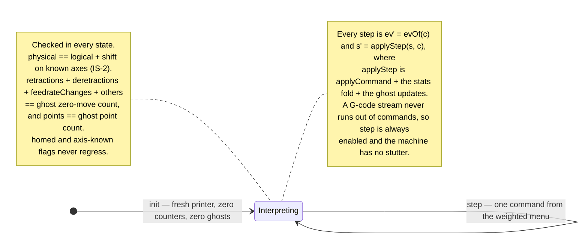
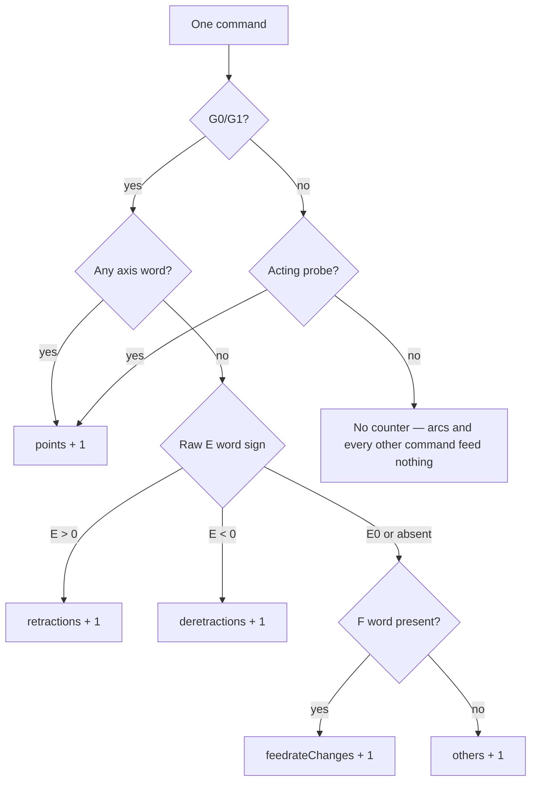

# Interpreter state machine: folding the shared printer core

A companion to `interpreter.qnt`. This is the flagship machine: it folds `printer_core::applyCommand` over a nondeterministic G-code stream and adds only what the core does not own — the job-statistics fold, the trace contract, generation weights, ghosts and invariants.

## What it models

The printer-state effects of the position and extrusion G-codes as the library observably executes them: linear moves (G0/G1), arcs (G2/G3, endpoint and E accounting only), units (G20/G21), homing (G28), straight probes (G31, G38.2–G38.5), set-position (G92, word and bare forms), shift reset (G92.1), extruder addressing (M82/M83) and tool selection (T0–T7). Alongside the printer state it tallies the five job-statistics counters: path points plus the four zero-length-move classifications.

All command semantics live in `lib/printer-core.qnt`, together with every per-command Authority / Library stance / Exclusions annotation. This machine contributes no transition of its own for the printer state; it is `applyCommand` plus a statistics fold driven by the core's `classifyLinear` and `probeActs`.

The state is one record `s`: the core's `PrinterState` under `s.p`, the counters under `s.stats`, and ghost fields (`ghostLogical`, `ghostZeroMoves`, `ghostPointMoves`, `ghostPrev`) that exist only so the invariants below are falsifiable. A second record `ev` is the trace contract: the command's canonical tag and its words in plain values, so an ITF trace doubles as a G-code program the replay feeds to the real parser and interpreter.

## The machine

The step menu draws, out of 18 weighted entries: linear moves 4 (split 3:2 axis-carrying vs zero-length), probes 3, G92 3, arcs 2, units 2, and one each of M82/M83, G28, G92.1 and tool select.

## Inside the stats fold

The raw E sign decides before anything else — a pinned decision: in absolute mode a positive E word that lowers the extruder position still counts as a retraction, outranking any F word. An explicit E0 falls through to F presence. An acting probe (no P word, at least one axis word) counts one point; arcs never do.

## Decisions and reasoning

### One semantics, imported

**Decision.** The machine imports `printer_core` and folds `applyCommand`; the only domain logic it adds is the statistics fold, expressed through the core's `classifyLinear` and `probeActs`.

**Reasoning.** The core is the single transcription of command semantics, already pinned by its own corner-case tests. A machine that re-stated axis updates or G92 arithmetic would reopen the exact divergence channel the shared core exists to close.

**Alternatives considered.** Keeping the stats fold in the core too; rejected — the counters are machine/trace state, not printer state, and other core importers (equivalence machines) do not want them. Writing the semantics inline as one action per command with hand-maintained `keep*` frame actions; rejected — it is a second transcription of the core, the divergence channel above.

### The defining equation is a ghost invariant

**Decision.** `ghostLogical` tracks the logical coordinate per axis, updated from the command words along its own derivation path, and `shiftDefiningEquation` checks `physical == logical + shift` on every known axis in every state.

**Reasoning.** This is IS-2's ShiftDefiningEquation — the one equation the whole G92 offset model derives from. With two independent derivations (applyCommand's shifted targets vs the ghost's unshifted words), a mis-transcribed move, home, G92, G92.1 or probe clause makes the invariant fail; a mutation test on the Home clause confirmed it does. The clamped probe is the one landing with no commanded logical coordinate, so its ghost case reuses the core's `probeTargetZ` minus the shift.

**Alternatives considered.** Stating the equation over history (after-the-fact replay of the command list through `applyAll`); rejected as a heavier encoding of the same check. Leaving the equation inside each transition's update formula and checking only structural invariants (tool range, non-negativity, unknown-is-zero, homed-implies-known); rejected — none of those can fail under a mis-transcription of G92 or units semantics.

### Conservation counters for the stats partition

**Decision.** `ghostZeroMoves` counts zero-length G0/G1 moves and `ghostPointMoves` counts axis-word moves plus acting probes, both from word presence alone; invariants pin `retractions + deretractions + feedrateChanges + others == ghostZeroMoves` and `points == ghostPointMoves`.

**Reasoning.** Every zero-length move must land in exactly one bucket, and nothing but axis moves and acting probes may count a point (arcs pinned to count none). Dropping any `statsAfter` branch breaks the partition sum — verified by mutation.

**Alternatives considered.** Per-counter prev-value monotonicity ghosts; the conservation form subsumes the interesting failure (a lost or double increment) in two invariants instead of ten.

### A flat event record

**Decision.** `ev` is one flat record of the canonical tag plus `has*`/`word*` pairs, derived in a single place (`evOf`, on top of `printer_core::cmdTag`), with absent words reading `false`/`0`.

**Reasoning.** The replay rebuilds a G-code line from `ev` alone; flat plain values keep the ITF decode trivial. Deriving every tag from the sum types in one def means no free string literal can drift.

**Alternatives considered.** Mirroring the core's `Word` options inside `ev`; rejected — ITF renders sum types as nested variant records, which the replay would have to unpick for no expressive gain. Scattered `cmd`/`has*`/`word*` state variables primed by layers of `record*` helper actions; rejected — tags and words assigned in many places can drift, which a single derivation rules out.

### Generation weights live in menus, shaped to the modes

**Decision.** Weighted literal lists drive every choice: the step menu; a 3:2 axis-vs-zero-length split for linear moves; a balanced four-way zero-move kind menu; a 4:1 word-vs-bare G92 menu; an inches-doubled units menu; a probe Z domain biased negative around the clamp plane.

**Reasoning.** Weights in data make each modeled mode a first-class sampling target, and changing one is a visible diff.

**Alternatives considered.** Deterministic directed traces per corner case; the semantic runs already pin those corners in-spec, and the replay needs volume more than scripts. Uniform `1.to(N).oneOf()` if-chains with independent per-word coins; rejected — they make the modes that matter rare: a bare G92 becomes a 1-in-16 event, a zero-length move 1-in-8, and inch-mode steps and probe clamps are seed luck.

### G28 axis letters and probe P values

**Decision.** G28 carries axis-presence flags rendered as bare letters (`G28 X`), and a probe's P word carries a rendered value so traces exercise both `P0` and `P1`.

**Reasoning.** The pinned decisions — G28 homes all axes regardless of its words; any P word, zero-valued included, makes the probe a no-op — are now observed by the replay rather than asserted in a comment. The P0 form specifically probes the presence-vs-truthiness seam.

**Alternatives considered.** Rendering G28 flags as `X0`; bare letters match what firmware documentation shows and exercise the parser's empty-value word path too. Replaying `G28` always bare and `P` always as `P1`; rejected — the word-ignoring G28 decision and the zero-valued P case would go unobserved.

### Monotonicity ghosts for the safety cluster

**Decision.** `ghostPrev` freezes the previous step's `homed` and per-axis `known` flags; `homedMonotone` and `knownMonotone` check they never regress.

**Reasoning.** "Nothing un-homes" is IS-4's HomedMonotone — a temporal claim, and the style rule says temporal claims are checked invariants or tagged OPEN. The prev-value ghost makes it a plain state invariant.

**Alternatives considered.** Leaving it to the core's comment; rejected by the rule above.

## Compared vs ignored

The replay in `src/__tests__/interpreter.ts` (`interpreter spec trace replay`) rebuilds each step's G-code line from `ev`, feeds it through the real `Parser` and `Interpreter` into one persistent `Job`, and compares after every step.

| Real-system observable                               | Replay treatment                                                            |
| ---------------------------------------------------- | --------------------------------------------------------------------------- |
| `state.x/y/z` with knownness                         | Compared: `undefined` iff the spec axis is unknown, else `centiMismatch`     |
| `state.e`                                            | Compared integer-exactly via `centiMismatch`                                 |
| `state.positionShift.x/y/z`                          | Compared integer-exactly via `centiMismatch`                                 |
| `state.relativeExtrusion`, `units`, `isHomed`, `tool` | Compared exactly per step                                                   |
| `job.stats` points/retractions/deretractions/feedrateChanges/others | Compared as exact integers per step                          |
| `job.paths`, vertices, arc tessellation              | Ignored — geometry output; owned by the arc/path describes of this file and the geometry suites |
| `job.boundingBox`                                    | Ignored — downstream of paths; owned by its own describes                    |
| `stats.extrusionDistance`, travel/extrusion partition | Ignored — not modeled; owned by the job suites                              |
| `state.extrusionWidth` / `lineHeight`                | Ignored — metadata pipeline, not command semantics; owned by the dimension describes |
| Feedrate as state                                    | Ignored — the library never stores or converts F (pinned); F matters only as presence in the classification |

Ghost fields (`ghostLogical`, `ghostZeroMoves`, `ghostPointMoves`, `ghostPrev`) are deliberately never decoded by the replay: they exist for property expression inside the model.

## Out of model

Numeric reality is the big exclusion: the spec lives on the integer centi-millimeter grid, so fractional words (`X10.25`, `E0.0432`, `X.5`), float rounding, NaN and non-finite or malformed words (`Xabc`, overflowing digit runs) cannot be expressed. Those live today in the `malformed coordinates through the whole pipeline` describe of `src/__tests__/interpreter.ts` and in `src/__tests__/parser.ts`.

Also out: G90/G91 (unregistered no-ops in the library — there is exactly one XYZ positioning mode, pinned once in the core header), F-word modality and Marlin's F conversion under G20 (the model carries F raw, presence-only), arc tessellation and plane selection (I/J/R ride along for line reconstruction only), probe hardware and trigger values, per-extruder E modes, and incremental `execute()` onto a pre-populated Job.

## Trace budget

Sized to this machine's own mode coverage: **25 traces × 30 steps × 2 seeds** (`0x67c0de2026` first, then `0xfab1e2026`), generated with `npx quint run verification/quint/interpreter.qnt --main interpreter --invariant allInvariants --max-steps 30 --n-traces 25 --max-samples 25 --out-itf 'verification/quint/traces/interpreter/trace_<seed-tag>_{seq}.itf.json'` per seed.

Stated minima and measured counts over the committed corpus of 50 traces (1500 post-init steps; stutter share is 0 by construction — the machine has no stutter):

| Metric                                         | Minimum | Measured |
| ---------------------------------------------- | ------- | -------- |
| Axis-carrying linear moves                     | ≥ 100   | 192      |
| … of which taken in inch mode                  | ≥ 40    | 90       |
| Zero-length linear moves                       | ≥ 80    | 122      |
| Retraction / deretraction / feedrateChange / other increments | ≥ 20 each | 32 / 29 / 31 / 30 |
| Arc moves                                      | ≥ 60    | 168      |
| Acting probes                                  | ≥ 60    | 154      |
| No-op probes (P word or no axis words)         | ≥ 20    | 97       |
| … replayed as `P0` / as `P1`                   | ≥ 20 each | 39 / 41 |
| Clamped probe landings (z-clamp fired)         | ≥ 20    | 28       |
| Word-form G92 / bare G92                       | ≥ 60 / ≥ 20 | 210 / 68 |
| Steps taken while in inch mode                 | ≥ 150   | 677      |
| G20 / G21 / G28 / G92.1 / M82 / M83            | ≥ 20 each | 94 / 51 / 86 / 84 / 41 / 46 |
| `G28` lines carrying axis letters              | ≥ 20    | 75       |
| Tool selections (T0–T7 combined)               | ≥ 40    | 87       |

The first 1200-step sizing attempt measured deretractions and clamped landings at 19 each; the budget was raised to 25 traces per seed and remeasured until every minimum held.

## Open items

`quint verify` has not been run — there is no JVM on this machine. Constructs suspected verify-hostile for a future Apalache lane: the wide per-step nondeterminism product (up to nine `nondet` picks in `anyArcMove`, which a bounded checker must encode as one large choice), `ev.cmd` as an uninterpreted string (equality-only, fine, but it widens the state vector for no checking value — a verify lane might project `ev` away), and the unbounded ghost counters, which would need a bound or an abstraction for bounded checking.

OPEN: per-counter monotonicity (each statistics counter never decreases) is implied by the conservation invariants plus the non-negative ghost deltas but is not stated as its own prev-value invariant.

OPEN: `centiMismatch`'s float-noise bound (1e-9 on the ×100 scale) is comfortable for every committed trace, but a pathological trace that pumps relative-mode inch E words monotonically for dozens of steps could accumulate rounding noise near that bound; if a regenerated corpus ever trips it, the E-word domain or trace length is the knob.

OPEN: path-level observables (per-step path count, last path type and endpoint) are not in this trace contract; binding geometry output to a spec remains future work, as does the streamed-vs-oneshot full-pipeline equivalence noted in `streaming.md`.
