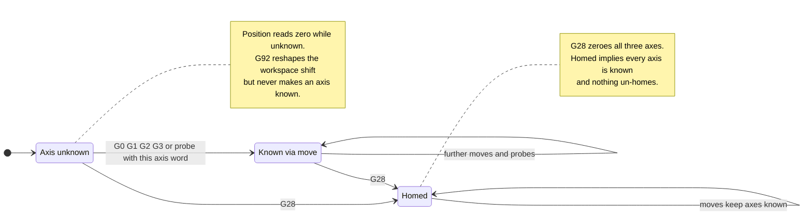
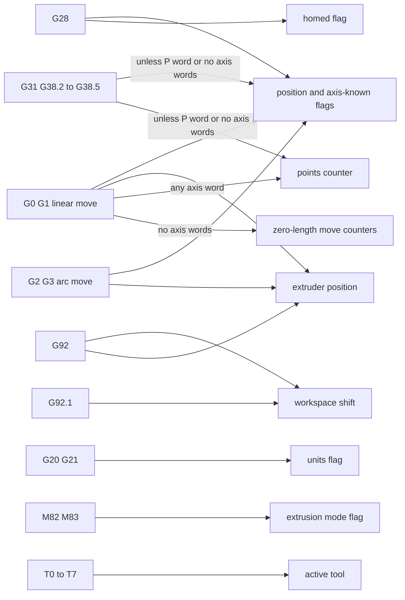
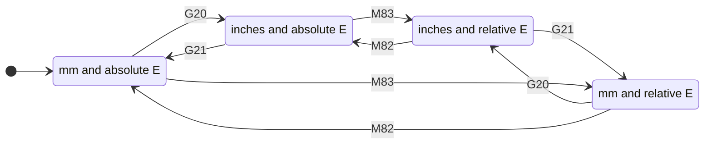

# Interpreter state machine, at a glance

A visual companion to `interpreter.qnt`, the formal spec of how a G-code stream drives printer state. The spec models the effects of motion commands, workspace offsets, unit and extrusion modes, homing, straight probes and tool selection on the tracked position, extruder axis and job statistics — firmware semantics only, independent of any implementation.

## Homing and axis knowledge

Each axis starts unknown and becomes known the first time something commands it. The diagram follows one axis; `G28` acts on all three at once.

The notes carry the spec's invariants: an unknown axis always reads zero (`unknownAxisIsZero`) and the homed flag implies all three axes are known (`homedImpliesKnown`).

## What each command class touches

This is a data-state machine, so the clearest map is which state fields each command class writes. Move targets are always computed through the current units factor and workspace shift.

A few pinned behaviors the arrows cannot show. Arc moves share a linear move's endpoint and extruder accounting but never touch the points counter. A zero-length linear move is classified by the raw sign of its E word first — a positive E word counts as a retraction even when, in absolute mode, the extruder position drops — then by F presence as a feedrate change, and otherwise as "others"; an explicit E0 falls through to the F check. A bare `G92` captures the current physical position as the shift and zeroes the extruder, while `G92.1` clears the shift and leaves the extruder alone. A probe aiming its shifted Z target below the origin plane, starting from a known Z at or above it, triggers at physical Z0 instead of traveling through.

## Units and extrusion modes

Two independent flags form a small lattice. Flipping one never disturbs the other, so opposite edges commute — the spec's `unitsModeCommuteTest` pins this down. Re-issuing the mode you are already in is a self-loop, omitted here for readability.

The active corner scales every incoming axis and E word — inches multiply by 25.4 — and decides whether an E word sets the extruder position outright or adds to it.
