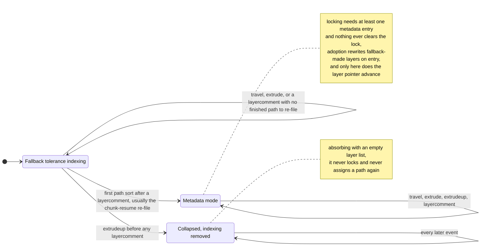
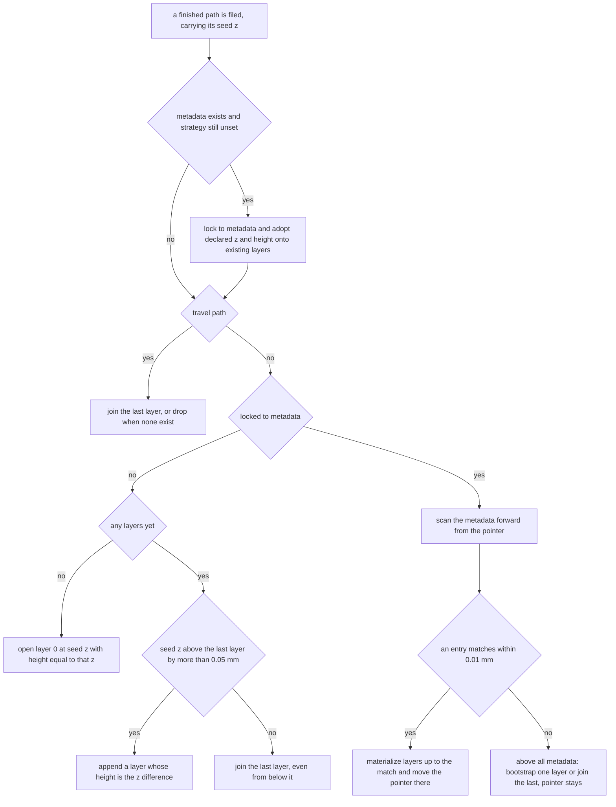
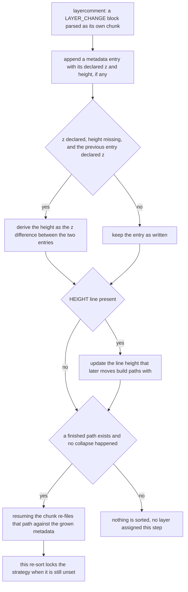

# Layer assignment across streamed chunks

This spec models how a print job groups extrusion paths into layers while G-code arrives chunk by chunk, one move line or slicer layer-comment block per step. All heights live in centi-millimeters, so the real tolerances, a 0.05 mm fallback break and a 0.01 mm metadata z-match, stay exact under integer comparison.

Two strategies compete. A tolerance fallback infers layers from upward z jumps between extrusions, while slicer LAYER_CHANGE comments feed a metadata mode that files paths against declared boundaries instead. The first path sorted after any metadata exists locks the choice to metadata forever; a non-planar extrusion before that point dissolves layer indexing for good.

## Strategy lifecycle

A stutter event self-loops in every mode without feeding input. The invariants pin this shape: the lock demands evidence of at least one slicer layer entry, the collapse keeps the layer list empty and the lock unset forever, and the metadata pointer stays at zero until the lock is taken.

## Filing one path

A path continued across several moves keeps the z it was seeded with, and filing reads that seed, so a non-planar extrusion in metadata mode files quietly by its seed z. Once collapsed, no path reaches this flow at all.

The invariants hold every filed path to exactly one existing layer and keep each layer's z and height in lockstep. While the fallback owns the list, z values climb strictly beyond the tolerance and heights telescope from zero, the first layer's height equaling its own z. The forward scan has one pinned detail: an entry with no declared z claims the path outright when its layer does not exist yet, and an undeclared or bootstrapped height defaults to 0.2 mm.

## A layer-change comment chunk

The re-file is the chunk-boundary resume behavior the spec models: executing the comment block as its own chunk re-sorts the last finished path, and that sort is the usual moment the strategy locks and adopts. A HEIGHT line also changes the line height that later moves carry, so the next move starts a fresh path seeded at the current z instead of continuing the old one. Metadata entries keep accumulating even after a collapse; they just never sort anything again.
