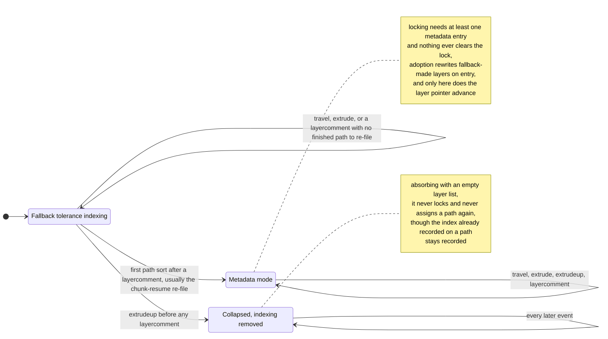
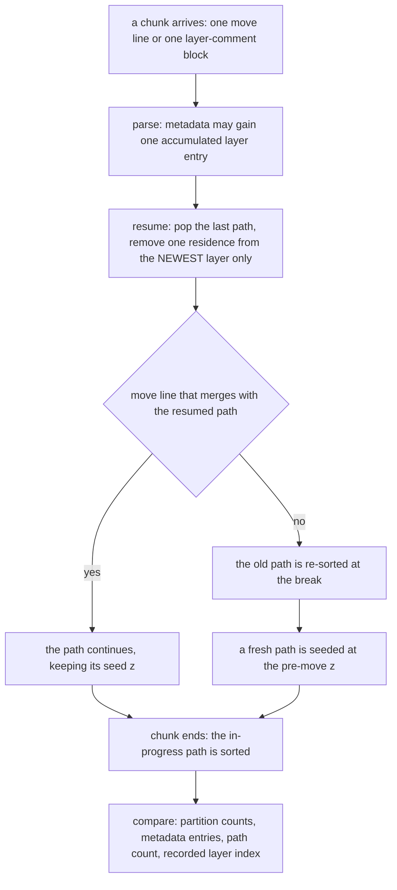
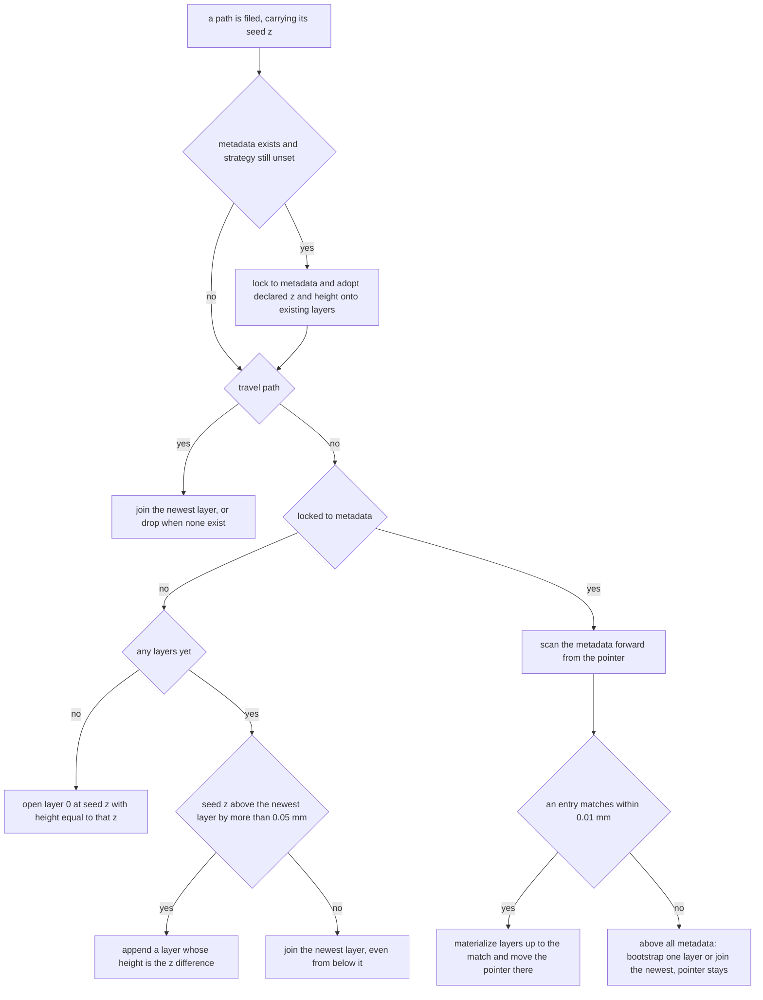

# Layer assignment across streamed chunks, v2

A companion to `layer-indexer.qnt`. This machine models the job's layer bookkeeping as G-code arrives chunk by chunk, one move line or one PrusaSlicer-style layer-comment block per step.

## What it models

Two strategies compete for the shared layer array. A tolerance fallback infers layers from upward z jumps between extrusions, while slicer LAYER_CHANGE comments feed a metadata mode that files paths against declared boundaries. The first path sorted after any metadata exists locks the choice to metadata forever, adopting the fallback-made layers; a non-planar extrusion before that point dissolves layer indexing for good.

What v2 adds over the v1 machine is the whole partition. Every state carries, per layer, the number of path entries resident in its paths array, plus the job's total path count and the layer index recorded on the last path. The replay compares all of it after every step, so the chunk-boundary resume — pop the last path, remove it from the newest layer, re-sort it when the chunk ends — is transcribed move for move rather than abstracted away.

All lengths are integers in centi-millimeters (`lib/scale.qnt`), so the real tolerances, a 0.05 mm fallback break and a 0.01 mm metadata z-match, stay exact under integer comparison.

## Strategy lifecycle

Each arrow is a checked invariant, not prose: lock, collapse, pointer, metadata length and path count all carry previous-step ghosts (`ghostPrev`), and `partitionConservation` balances every resident count against a filings-minus-removals counter kept along an independent path.

## One step through the chunk pipeline

The newest-layer removal is the detail the partition counts exist to pin. A path re-filed below the newest layer — which adoption routinely causes — is out of the removal's reach, so each chunk boundary adds another residence entry for it in that lower layer. The spec reproduces those counts exactly and the replay verifies them against the real arrays.

## Filing one path

The forward scan keeps its pinned details from v1: an entry with no stored z claims the path outright when its layer does not exist yet and is pinned by that path's z, and an undeclared or bootstrapped height defaults to 0.2 mm. A filed path gets its layer index recorded; the record is sticky, surviving drops, no-sort steps and the collapse itself.

## Decisions and reasoning

### The trace contract carries the full partition

**Decision.** `s.layers` holds `{z, h, n}` per layer where `n` is the resident path-entry count; `s.pathsCount` and `s.last.idx` carry the job's path total and the last path's recorded layer index. The replay compares every field on every step.

**Reasoning.** Layer z/height arrays alone cannot see a path moving between layers, a residence entry appearing twice, or a filing that lands in the right layer by the wrong route. Counts make the membership side of the partition mechanically bound.

**Alternatives considered.** Comparing full path-identity lists per layer would bind even harder but needs path identities in the trace, which ITF cannot carry without naming every path; counts plus the last path's index catch the same transcription errors in practice.

**What v1 did.** Compared only `layersZ`/`layersH` and, on positive assignments, the last path's `layerIndex`. Membership of earlier paths was never re-verified.

### Negative outcomes assert something real

**Decision.** `ev.outcome` distinguishes `filed`, `dropped`, `collapse` and `nosort`, and `s.last.idx` is asserted on every step: `-1` must read back as a path with no recorded layer index, and a sticky value must still be recorded, unchanged, after drops, no-sorts and the collapse.

**Reasoning.** v1's `-1` skipped the assertion entirely, so a path wrongly filed during a "dropped" step passed. Modeling the recorded index as sticky state turns every negative step into an exact assertion.

**Alternatives considered.** Capturing the pre-step index in the harness and asserting "unchanged" would work without spec state, but moves the oracle into the harness; carrying the expected value in the trace keeps the harness a pure comparator.

**What v1 did.** "Only positive assignments are asserted" — the harness comment said so outright.

### The chunk-boundary resume is transcribed, not abstracted

**Decision.** Every step models the real pipeline order: resume (newest-layer removal), a re-sort of the broken path at the break, then the final sort at the chunk's end. `occ` tracks the live path's residences so the removal's hit-or-miss is exact.

**Reasoning.** With resident counts in the contract, the two-sort shape of a type break and the newest-layer-only removal become observable; the single-sort abstraction v1 used would disagree with the real counts within a few steps of any adoption. The below-newest residence growth this produces is pinned behavior, stated neutrally and verified exactly (`metadataLockAdoptionResidenceTest`).

**Alternatives considered.** Keeping v1's single-sort abstraction and dropping counts from the contract — rejected, it is the critique's headline gap for this machine.

**What v1 did.** One `sortPath` per step; the re-sorts' effects on membership were invisible to the compared observables.

### Every monotonicity claim is a checked invariant

**Decision.** `ghostPrev` freezes the pointer, lock, collapse flag, metadata length, layer count and path count each step; `pointerMonotone`, `lockMonotone`, `collapseMonotone`, `metaMonotone`, `layersMonotoneUnlessCollapsed` and `pathsMonotone` check them. `partitionConservation` and `liveResidencySingleLayer` make the count bookkeeping falsifiable.

**Reasoning.** v1's header claimed a "monotone metadata layer pointer" that no invariant checked. Mutation checks during construction confirmed the suite bites: breaking the `n` increment or the removal guard fails simulation in milliseconds, and a pointer-rewind mutation fails two semantic runs.

**Alternatives considered.** Temporal operators under `quint verify` — no JVM on this machine; ghost state under simulation is equivalent here.

**What v1 did.** `pointerBounded` and `unlockedPointerZero` only; monotonicity lived in comments and one scripted run.

### Parser-side metadata layers join the contract

**Decision.** `s.meta` mirrors the parser's accumulated `layerMetadata`: stored-z and stored-height presence and values (including the cross-chunk derived height, which may be zero or negative when z regresses) and positional `layerIndex`. The replay compares them against `parser.metadata.layerMetadata` every step.

**Reasoning.** The job's layers are a downstream projection; comparing the accumulator pins the metadata pipeline the indexer consumes — entry append, height derivation at chunk boundaries, positional numbering — where v1 kept it model-internal.

**Alternatives considered.** Comparing `lineIndex` too; left out because modeling line counts would re-specify the accumulator arithmetic owned by the JL-4/PA-6 suites, for little added falsifiability here.

**What v1 did.** `metaLayers` existed but was explicitly "not compared directly by the replay".

### Two state variables, sum types, no stutter

**Decision.** Exactly `var s: SpecState` and `var ev: Event`; transitions are pure (`applyMove`, `applyComment`); `PathKind`, `EvKind`, `Outcome` and `StepKind` are sum types with strings derived once each; the machine has no stutter because a G-code stream never runs out of lines, so `step` is always enabled.

**Reasoning.** House style (STYLE.md). Dropping v1's 1-in-20 stutter also stops spending trace budget on steps that assert nothing new.

**Alternatives considered.** Importing `lib/printer-core.qnt` and folding moves through `applyCommand` — declined: this machine consumes only the z effect of moves (no shifts, units or E accounting are generated), so the core would add coupling to IS-* semantics without making any layer claim more falsifiable. The interpreter machine owns that surface.

**What v1 did.** Fifteen scattered scalar vars, stringly-typed `cmd`/`lastPathType`, a hand-primed `stutterStep`.

### Generation is phase-weighted, sized to the rare modes

**Decision.** Two 20-entry menus, drawn by phase: before any metadata, moves dominate (travel 6, extrude 10, extrudeup 1, comment 3) so the fallback can stack layers; after it, comments and non-planar extrusions are denser (5/7/2/6). Comment `;Z:` presence is 3:1 and its values are upper-biased (`HZ_BAG`, `CZ_BAG`).

**Reasoning.** The partition modes worth stressing are reachable only through specific prefixes: adoption needs multiple fallback layers before the first comment, and below-newest residence additionally needs an adopted boundary above the fallback stack. Uniform draws left both nearly unsampled; the first 20-trace sizing attempt measured 15 below-newest steps and 9 sticky-index steps, so the bags above were introduced and the budget raised to 25 per seed until every minimum held.

**Alternatives considered.** One uniform menu with a bigger budget — measured, and the rare modes stayed rare (0–16 steps across whole corpora); the shape of the prefix, not the volume, was the gate.

**What v1 did.** One `1.to(20).oneOf()` if-chain; the corpus reached the collapse in 2 of 15 traces and never exercised below-newest residence at all.

## Compared vs ignored

The replay in `src/__tests__/indexers.ts` (`layer-indexer v2 spec trace replay`) drives one streaming `Parser`/`Interpreter`/`Job` per trace, one chunk per step.

| Real-system observable                               | Replay treatment                                                            |
| ---------------------------------------------------- | --------------------------------------------------------------------------- |
| `job.layers.length`, each layer's `z` / `height`     | Compared per step, integer-exactly via `centiMismatch`                       |
| `job.layers[i].paths.length`                         | Compared per step against `s.layers[i].n` — the full partition               |
| `job.paths.length`                                   | Compared per step against `s.pathsCount`                                     |
| `job.paths[last].layerIndex`                         | Compared per step, including `undefined` and sticky stale values             |
| `parser.metadata.layerMetadata` (z, height, layerIndex) | Compared per step, presence and exact value; positional numbering checked |
| `console.warn` on the non-planar collapse            | Asserted exactly once, on the `collapse` step                                |
| `layerMetadata[i].lineIndex`                         | Ignored — line accounting is owned by the parser/job suites (JL-4, PA-6)     |
| travels / extrusions / toolPaths partitions          | Ignored — JL-1 territory, not layer indexing                                 |
| `job.stats`, vertices, bounding box                  | Ignored — owned by the interpreter machine and geometry suites               |
| `state.extrusionWidth` / `state.lineHeight` values   | Not compared directly; their path-breaking effect is what this machine pins  |

## Out of model

Moves carry only X, Z and E words: no workspace shifts, units changes, tools or relative extrusion reach this machine (the interpreter machine owns them), so a path's seed z is always the raw command z. Layer-comment blocks are never split across chunks, carry no `;LAYER:n` explicit indices and no `;WIDTH:` lines, and their Z/HEIGHT payloads are always well-formed numbers — the parser's reject paths are unit-tested in the parser suites. The tolerance is the default; a `Job` built with a custom `minLayerThreshold` is out of scope.

The metadata-pointer rewind on installing a different metadata array identity is excluded, deliberately: see Open items.

## Trace budget

Sized to this machine's rare partition modes rather than v1's uniform 15×24: **25 traces × 30 steps × 2 seeds** (`0x67c0de2026` first, then `0xfab1e2026`), generated per seed with `npx quint run verification/quint/layer-indexer.qnt --invariant allInvariants --max-samples 25 --n-traces 25 --max-steps 30 --seed=<seed> --out-itf 'verification/quint/traces/layer-indexer/trace_<seed-tag>_{seq}.itf.json' --verbosity 1`.

Stated minima and measured counts over the committed corpus of 50 traces (1500 post-init steps; stutter share is 0 by construction — the machine has no stutter):

| Metric                                               | Minimum | Measured          |
| ---------------------------------------------------- | ------- | ----------------- |
| travel / extrude / extrudeup / layercomment steps    | ≥ 250 / 400 / 80 / 300 | 385 / 561 / 134 / 420 |
| `filed` / `dropped` / `nosort` outcomes              | ≥ 800 / 20 / 200 | 1075 / 37 / 374 |
| `collapse` events (= traces reaching the collapse)   | ≥ 10    | 14                |
| Traces locking to metadata mode                      | ≥ 25    | 36                |
| Locks that adopt already-existing fallback layers    | ≥ 15    | 25                |
| Metadata-mode / fallback-mode filings                | ≥ 600 / 80 | 945 / 130      |
| Steps with the metadata pointer advanced (> 0)       | ≥ 150   | 252               |
| Steps with a residence below the newest layer        | ≥ 25    | 51                |
| Steps pinning a sticky recorded index after collapse | ≥ 15    | 23                |
| Accumulated entries with a derived height            | ≥ 50    | 82                |
| … of which zero or negative (z regression)           | ≥ 20    | 53                |
| Entries with no stored z (claim/pinning rule)        | ≥ 60    | 107               |
| Merged re-files (filed with no new path)             | ≥ 400   | 656               |

The collapse minimum is the one figure held below ~20 on purpose: the mode is absorbing, so each extra collapse trace converts its remaining steps into `nosort` tail, and 14 replayed collapses already dwarf v1's 2.

## Open items

`quint verify` has not been run — there is no JVM on this machine. Constructs suspected verify-hostile for a future Apalache lane: the unbounded growing lists (`layers`, `meta`, `occ`) whose lengths only the step budget bounds, and the fold-based forward scans (`findTarget`, `ensureUpTo`).

OPEN: the pointer rewind on installing a metadata array with a different identity stays unmodeled. Through the parser-driven flow this machine replays, it is unreachable: the parser accumulates all layer entries into one array whose identity never changes once created, the job forwards that same reference every chunk, and the indexer's same-reference install is a no-op. Before the first entry exists the job installs a fresh empty array each chunk, which rewinds a pointer that is still zero. Only a direct `setLayerMetadata` caller swapping arrays mid-job can observe the rewind; that behavior stays covered by the unit describes earlier in `src/__tests__/indexers.ts`.

OPEN: `liveResidencySingleLayer` is checked under simulation for this machine's event alphabet; it is a consequence of the modeled flow (stable re-file targets plus newest-layer removal), not a claim about arbitrary call orders against the indexer API.

`layerMetadata[i].lineIndex` is not compared (see the table); if a future machine models line accounting, it belongs beside the dimension-event fold of JL-4 rather than here.
