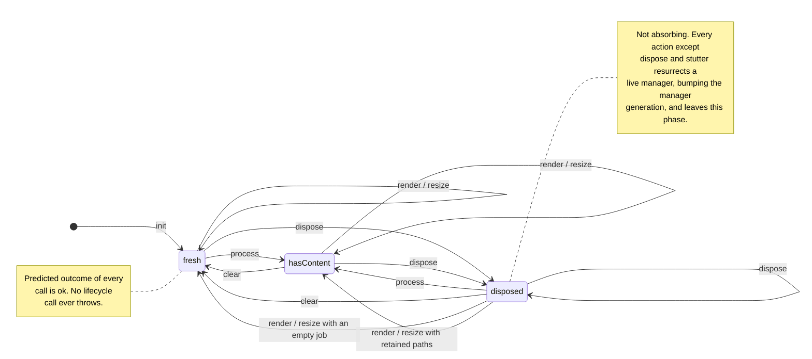
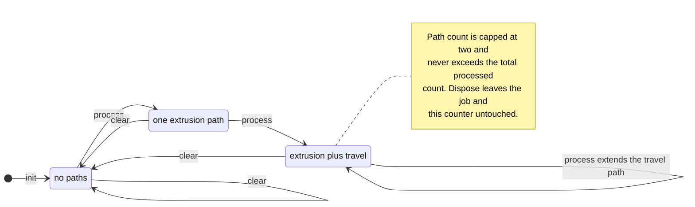

# Lifecycle automaton

A companion to `lifecycle.qnt`, the spec of the preview's public lifecycle calls: process, clear, render, resize and dispose. The model predicts the preview's observable phase, how many paths one fixed single-move G-code snippet grows per job epoch, and how many scene-manager generations exist, so every trace doubles as a call script for the replay harness.

## Phase machine

The spec pins two invariants onto this picture: the automaton can only sit in `disposed` immediately after a dispose or a stutter, and the phase always matches the job, so `fresh` means zero paths and `hasContent` means at least one. The `dispose` self-loop and the `clear` self-loop are the idempotent cases the spec tests explicitly. A `stutter` action self-loops on every phase and is omitted above.

## Job growth within an epoch

The job is retained across dispose and only replaced by clear, so path growth has its own small machine. The snippet uses absolute extrusion: the first process of an epoch lays an extrusion path, replaying the same move extrudes nothing and so adds a travel path, and every later process merely extends that travel path.

Dispose, render, resize and stutter do not appear here because none of them changes the job.
