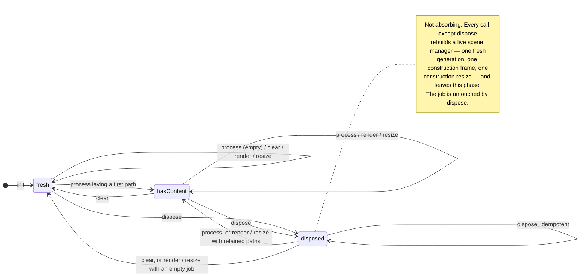
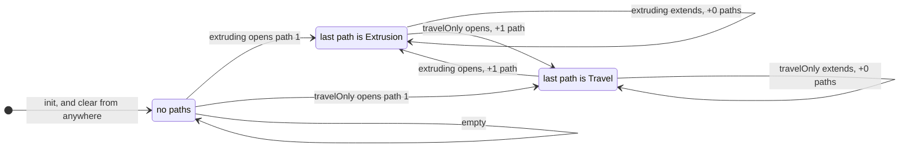

# Public-API lifecycle: the resurrection machine

A companion to `lifecycle.qnt`. This spec pins the preview facade's observable lifecycle — process, clear, render, resize and dispose — including the design decision at its heart: dispose tears down only the rendering side, and the next call that touches rendering lazily resurrects a fresh scene-manager generation.

## What it models

Every trace doubles as a call script. Each step names one public lifecycle call, and for process it also names which snippet from a three-item menu was fed, so the replay constructs a real `GCodePreview` (with only three.js' `WebGLRenderer` stubbed), makes exactly the calls the trace made, and compares the preview's observables after every one.

The observables go well past phase and path count. The spec carries the cumulative number of `renderer.render` calls, `renderer.setSize` calls and `renderer.dispose` calls across every generation the preview has created, plus the kind of the job's most recent path. All counts assume the replay's inert `requestAnimationFrame`: the continuous presentation loop contributes exactly its first, synchronous frame per scene-manager generation, and no asynchronous frame ever fires, which is what makes the renderer arithmetic deterministic.

The machine's state is one record `s` (phase, path counters, generation counter, renderer observables, plus the ghost block), advanced only by pure transition functions. A second record `ev` is the trace contract: which call ran, which snippet it fed, and whether the step resurrected the scene manager.

## The phase machine

The spec checks this picture with ghost state rather than narrating it. `disposedExactlyAfterDispose` says the machine sits in `disposed` exactly when the step just taken was a dispose, `resurrectionExactlyFromDisposed` says a generation is created exactly by leaving the disposed phase, and `disposeRetainsJob` says the path count crosses a dispose unchanged. A transition transcribed wrongly in any of these respects fails simulation in milliseconds.

## Job growth under the snippet menu

Path growth belongs to the last path's kind, not to a call counter. A snippet whose move matches the last path's kind extends that path; a snippet whose move differs opens a new one; the empty snippet touches nothing.

Dispose, render and resize do not appear: none of them changes the job. The `emptyIffNoLastPath` and `onlyClearShrinksJob` invariants keep this machine honest, and the replay checks the real job's last `travelType` against it on every step.

## Decisions and reasoning

### A snippet menu with declared deltas

**Decision.** `process` draws nondeterministically from three snippets, each carried in the trace by name with a declared path-growth rule: `extruding` is `G92 E0` + `G1 X10 Y10 E1`, `travelOnly` is `G0 X5 Y5`, `empty` is a bare comment line.

**Reasoning.** The `G92 E0` reset makes the extruding snippet lay material on every feed, so each snippet's effect depends only on the last path's kind — a fact of the implementation's path-continuation rule, not of one snippet's arithmetic. The model becomes a real lifecycle model: path counts grow without bound, both open-new-path and extend-existing-path deltas recur, and the replay knows exactly which G-code to feed because the trace says so.

**Alternatives considered.** An `M83` (relative extrusion) prologue would also re-extrude every time, but it flips a modal state the menu would then have to carry; the `G92 E0` form leaves every mode at its default. A menu with varying widths/heights was rejected: dimension-driven path breaks belong to the metadata pipeline, not this machine. One fixed snippet such as `G1 X10 Y10 E1`; rejected — its absolute-E arithmetic caps the job at two paths per epoch, smuggling interpreter behavior into the lifecycle spec, and the model would have to be rewritten whenever the snippet changed.

### Renderer call counts are in-model observables

**Decision.** `s` carries cumulative `renders`, `setSizes` and `rendererDisposes`, billed by each transition: a construction frame and a construction resize per generation, one render per explicit `render()` and per `clear()` re-render, one animated-render first frame per process that leaves more than one path, one setSize per `resize()`, one renderer dispose per generation retirement.

**Reasoning.** The replay sums the stub renderers' mock call counts over the trace's window and compares integer-exactly every step, so a resurrection that skipped its construction frame, a clear that stopped re-rendering, or a double renderer dispose is caught at the exact step it happens. In-model, two conservation equations (`renderConservation`, `setSizeConservation`) tie the cumulative counts to independent per-action ghost counters, so mis-billing any single transition breaks an equation.

**Alternatives considered.** Keeping the counts replay-side only (deltas recomputed by the harness) would leave the spec unable to state the conservation equations. Counting `setPixelRatio` too was rejected: it tracks `setSize` one-for-one and would add a column without adding information.

### A three-phase machine; ghosts make its claims checkable

**Decision.** Keep a three-phase automaton with disposed non-absorbing, exactly as the implementation behaves, and back every temporal claim about it with an invariant over ghost state: `ghostJustDisposed`, `ghostJustCleared` and the frozen `ghostPrev` record.

**Reasoning.** The resurrection semantics is the pinned heart of this machine, so its claims must be falsifiable. With the ghost block, "disposed only right after dispose", "a generation is created exactly by leaving disposed", "dispose retains the job" and "only clear shrinks the job" are all checked on every simulated state — and each was observed to fail under deliberate transition mutations during construction.

**Alternatives considered.** Deriving phase from `pathCount` plus a liveness bit instead of storing it; storing the sum type plus `phaseMatchesContent` was chosen so a transition error has one more way to fail. Stating the dispose claim as one invariant over the trace-contract `cmd` string; rejected — that is an action property coupled to the replay plumbing, where ghost state checks it on every simulated state.

### The no-throw contract moved to the replay

**Decision.** There is no `outcome` field and no `neverThrows` invariant. The replay asserts `ok` on every call, and additionally collects asynchronous rejections of the animated-render promises and requires none by the end of each trace.

**Reasoning.** Inside the model a constant can never fail, so as a spec invariant the claim was decorative. As a replay assertion it is live on all 930 replayed states — and covers the asynchronous failure path as well.

**Alternatives considered.** Keeping `outcome: "ok"` in `ev` for self-documentation; rejected as exactly the vacuous-constant pattern: inside the model it can never fail.

### Always-enabled step, no stutter

**Decision.** Every lifecycle call is total in every phase, so `step` is always enabled and the machine has no stutter action.

**Reasoning.** A stutter exists to keep `step` enabled, but this machine never exhausts anything; without it, every committed step is a real call the replay exercises.

**Alternatives considered.** A 10% `doStutter` branch the replay skips; rejected — this machine never needs a stutter to keep `step` enabled, and every stutter step is one the replay does not exercise.

### Inert frames as the clock model

**Decision.** The replay stubs `requestAnimationFrame` to hand out ids and never fire, and the spec's counts are defined against that clock: construction and the animated render each contribute exactly their first, synchronous frame, and the animated-render promise stays pending.

**Reasoning.** The continuous presentation loop renders once per real frame, which no step-indexed model can count. Pinning the synchronous prefix makes the arithmetic exact and the suite deterministic, while generation identity, job growth and the dispose ledger — the lifecycle substance — are unaffected by how many frames would have fired.

**Alternatives considered.** A controllable frame queue flushed a fixed number of times per step would re-admit the loop at the cost of arbitrary flush constants in both spec and harness. Letting real frames run during the replay; rejected — the loop renders once per real frame, which no step-indexed model can count, and awaiting the animated render makes step timing depend on the frame scheduler.

## Compared vs ignored

The replay in `src/__tests__/renderer-smoke.ts` (`lifecycle spec trace replay`) applies each trace's calls to a real `GCodePreview` built exactly as the smoke tests build theirs: every three.js class real except `WebGLRenderer`, no module-level mocks of library code, no un-mocking machinery.

| Real-system observable                                   | Replay treatment                                                            |
| -------------------------------------------------------- | --------------------------------------------------------------------------- |
| Call outcome (sync throw)                                 | Asserted `ok` on every step; pinned no-throw contract                        |
| Async rejection of animated-render promises               | Collected per trace; required empty at the end                               |
| `job.paths.length`                                        | Compared per step against `s.pathCount`                                      |
| `travelType` of the job's last path                       | Compared per step against `ev.lastPath`                                      |
| Renderers constructed (generations)                       | Compared per step against `s.managerGen`                                     |
| `renderer.render` calls, summed over all generations      | Compared integer-exactly against `s.renders`                                 |
| `renderer.setSize` calls, summed over all generations     | Compared integer-exactly against `s.setSizes`                                |
| `renderer.dispose` calls, summed over all generations     | Compared integer-exactly against `s.rendererDisposes`                        |
| `_sceneManager` nullness                                  | Compared against `ev.phase` (`disposed` means exactly null)                  |
| `_sceneManager` identity across steps                     | Must change exactly when `ev.resurrected`, else stay the same instance       |
| `setPixelRatio` calls                                     | Ignored — tracks `setSize` one-for-one                                       |
| Scene contents, cameras, controls, geometry               | Ignored — owned by the smoke tests above and the scene-manager suites        |
| Frames after the first per generation                     | Ignored — out of the inert-frame clock model by construction                 |

No millimeter quantities appear in this machine, so the shared helper's `centiMismatch` is unused here; every number is a call or path count compared with `===`.

## Out of model

The streaming entry points (`processGCodeStream`, `readStream`) and their interleavings with clear are a different machine and are not modeled. Neither are the `onJobUpdated`/`onStreamEnd` callbacks, constructor options beyond the replay's fixed record (colors, droppable, build volume variations), the wider Disposable ledger beneath the renderer (controls, objects manager, geometries — owned by the scene-manager suites), layer metadata and dimension-driven path breaks (the snippet menu never changes widths, heights or tools), and everything the animated render would draw after its first frame.

## Trace budget

Sized to this machine's diameter: **15 traces × 30 steps × 2 seeds** (`0x67c0de2026` first, then `0xfab1e2026`), generated per seed with `npx quint run verification/quint/lifecycle.qnt --invariant allInvariants --max-samples 15 --n-traces 15 --max-steps 30 --seed=<seed> --out-itf 'verification/quint/traces/lifecycle/trace_<seed-tag>_{seq}.itf.json' --verbosity 1`.

The weighted `STEP_MENU` (process 4/10 with extruding doubled, dispose 3/10, clear/render/resize 1/10 each) makes the disposed phase a frequent launch point, so every dispose-then-X resurrection pair is common rather than seed luck. Stated minima and measured counts over the committed corpus of 30 traces (900 post-init steps):

| Metric                                      | Minimum | Measured |
| ------------------------------------------- | ------- | -------- |
| process steps                               | ≥ 200   | 341      |
| dispose steps                               | ≥ 150   | 293      |
| clear steps                                 | ≥ 60    | 80       |
| render steps                                | ≥ 60    | 98       |
| resize steps                                | ≥ 60    | 88       |
| extruding snippet feeds                     | ≥ 100   | 183      |
| travelOnly snippet feeds                    | ≥ 60    | 85       |
| empty snippet feeds                         | ≥ 60    | 73       |
| dispose → process resurrections             | ≥ 50    | 111      |
| dispose → clear resurrections               | ≥ 20    | 21       |
| dispose → render resurrections              | ≥ 20    | 30       |
| dispose → resize resurrections              | ≥ 20    | 31       |
| dispose while already disposed (idempotent) | ≥ 40    | 90       |

## Open items

`quint verify` has not been run — there is no JVM on this machine. This automaton is small and bounded apart from its monotone counters, so it is a natural first candidate for a bounded Apalache lane once one exists.

The runner manifest (`scripts/quint-specs.mjs`) carries the `lifecycle` entry, and the freshness gate reproduces the committed corpus exactly.

`renderConservation`'s animated-frame term and the transition that bills it share the `pathCount > 1` predicate, so that one term is cross-checked primarily by the replay rather than by the equation. The per-generation attribution of calls (which generation's renderer received which call) is derivable from the trace but compared only as window-wide sums.
