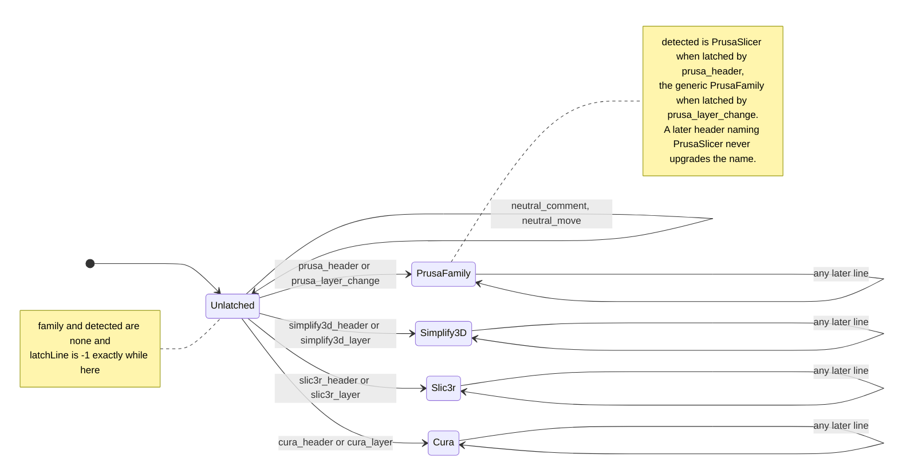
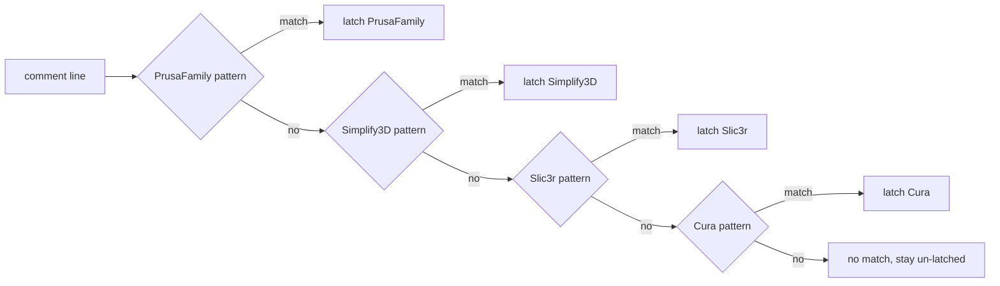

# Slicer detection latch

This spec models slicer detection over a streaming G-code file as a write-once latch. Each step observes one line; the first line carrying a known slicer marker fixes both the classification and the reported slicer name for the rest of the stream, and no later line is ever examined again.

## The latch

Marker lines only latch out of the un-latched state; neutral lines loop there forever without latching. Every latched state self-loops on all later lines, markers for rival slicers included: the latchMonotone invariant pins the classification and the reported name to the first ones ever taken.

## First-match priority within one line

Detection tries the families in the fixed order PrusaFamily, Simplify3D, Slic3r, Cura and takes the first match. The spec pins one consequence of this order: the PrusaSlicer header text also matches Slic3r's version pattern, yet it always latches PrusaFamily because PrusaFamily is consulted first. Across the stream, though, the latch is strictly first-come — a Cura marker seen before any Prusa marker latches Cura, and the higher-priority family can never displace it.

Beyond monotonicity, the invariants require that the family and the reported name are set together or not at all, that the reported name always belongs to the latched family, with only PrusaFamily resolving to a more specific generator name, and that latchLine names a line that was actually observed.
