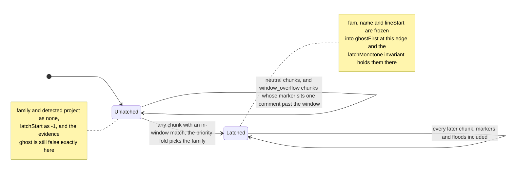
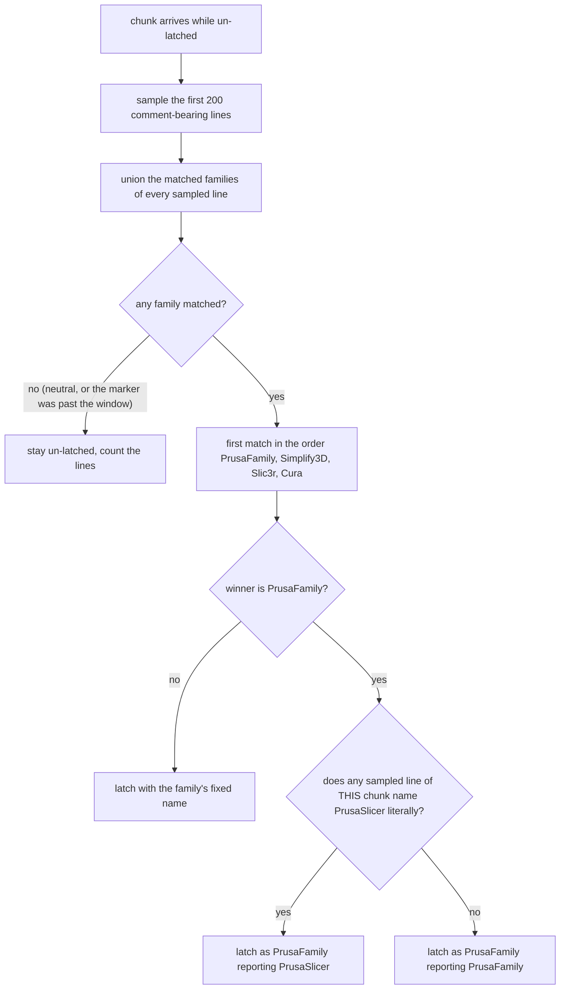

# Slicer detection latch, v2: windowed, priority-resolving, write-once

A companion to `slicer-detector.qnt`. The machine pins unit PA-3: a streamed parse classifies its slicer at most once, through a fixed priority order, from a bounded sample of each chunk's comments — and never revisits that decision.

## What it models

A G-code stream reaches the parser as chunks. While nothing is latched, every chunk is examined: its first `WINDOW` (200) comment-bearing lines are sampled, each sampled line contributes the set of parser families whose identification patterns it matches, and the first family in the fixed order PrusaFamily, Simplify3D, Slic3r, Cura that appears anywhere in that sample wins. The winner latches together with the reported slicer name, which is resolved from the latching chunk alone — the PrusaFamily parser upgrades its generic name to `PrusaSlicer` when any in-window line of that chunk names the generator literally. Once latched, later chunks only advance the line count.

Each step delivers one chunk: a single line, an ordered pair of lines, or a window flood — `WINDOW - 1` or `WINDOW` neutral filler comments followed by one marker line, placing that marker exactly on, or exactly past, the last sampled slot. Detection is data, not hard-coded outcomes: every line kind carries its matched-family set, and the spec's priority fold computes each chunk's winner. The event-to-line mapping is part of the contract — per line kind the replay holds a set of representative line strings (case and boundary variants included) and iterates all of them.

The state is one record `s` (the latch as a sum type, plus ghosts), advanced only by the pure `applyChunk`. The record `ev` is the trace contract: the chunk delivered (kind, line tags, filler count) and the latch projection after the step, in plain strings and integers.

## The latch

## Inside one chunk: window, priority, name

Priority ranks families, never line positions: a chunk pairing a Cura line before a Prusa line still latches PrusaFamily. Across chunks the latch is strictly first-come — a Cura marker seen in an earlier chunk latches Cura, and the higher-priority family can never displace it.

## Decisions and reasoning

### Detection is data; the priority theorem is an invariant

**Decision.** Every line kind carries a matched-family set (`matchedFamilies`), the chunk winner is computed by `firstByPriority`, and `priorityRespected` checks — against a second, independent encoding of the order (`priorityIndex`) — that the latched family belongs to the latching chunk's in-window set with no higher-priority family present.

**Reasoning.** The genuinely risky logic is pattern precedence over an open set of lines. With the resolution modeled, a mis-transcribed fold, a reordered menu, or a wrong matched set fails in simulation; the ghost `ghostLatchFams` makes the theorem checkable on every state.

**Alternatives considered.** Deriving the replay's line table from the spec file itself (single source); rejected — ITF carries no strings-to-regex bridge, and the replay's contract test closes the same gap.

**What v1 did.** Each event hard-coded its resolved `(family, name)` outcome, so the order existed only in comments and no invariant could falsify it.

### Multi-line chunks make within-chunk priority reachable

**Decision.** Pair events deliver two ordered lines in one chunk. A curated conflict menu (`CONFLICT_PAIR_MENU`) generates pairs whose winner always sits on the second line, covering every ordered adjacent-family hop, with ambiguous lines on both sides.

**Reasoning.** With one line per chunk, "priority applies within one detection attempt" is unreachable by construction; random pairs land the conflict shape too rarely (once in an early 600-step corpus). The curated menu lifts that mode above the stated minimum while generic random pairs keep exploring the rest of the square.

**Alternatives considered.** Chunks of arbitrary length; rejected — two lines already distinguish position from priority, and longer chunks only dilute the corpus.

**What v1 did.** Fixed one line per chunk, so within-chunk priority was never exercised by any trace.

### The sampling window is modeled on both sides of its edge

**Decision.** `WINDOW = 200` is in the spec. `window_edge` chunks put a marker on the last sampled comment slot (latches); `window_overflow` chunks put it one slot later (must not latch, while the chunk's lines still count). The `latchIffEvidence` invariant derives its evidence ghost from in-window nonemptiness directly — not through the priority fold — so a detector reading beyond the window fails it.

**Reasoning.** The window restarts per chunk, because detection re-runs on every chunk while un-latched; that makes the bound invisible to one-line-per-chunk models and to any corpus without window-sized chunks. Pinning both sides of the edge is what makes an off-by-one in the sample slice observable.

**Alternatives considered.** A smaller model window with a scaled replay; rejected — the replay feeds 200 real filler lines in milliseconds, and an unscaled bound keeps the contract literal.

**What v1 did.** The 200-comment window was unmodeled; detection was only ever exercised within the first lines of a stream.

### Representative sets, not single lines, are the event contract

**Decision.** Per line kind the replay owns a set of representative strings — case variants, spacing variants, a second marker form per family, and one ambiguous line per adjacent family pair. Every trace is replayed once per representative column, and a contract test feeds each string alone to a fresh parse, asserting the exact family and name it latches.

**Reasoning.** A single hard-coded line per event lets pattern facts rot silently: an edit to a regex that changes a variant's matched set now fails a named assertion even if no random trace leads with that variant. Within a kind, all representatives match the same family set and carry the same generator literal, so passes are interchangeable by construction — and the contract test is what proves that construction.

**Alternatives considered.** Random per-step representative choice; rejected — pass-indexed iteration is deterministic and covers every string without a seed.

**What v1 did.** One line per event forever, with cross-matching asserted in comments only.

### Name resolution reads the whole latching chunk

**Decision.** `resolveName` upgrades PrusaFamily to `PrusaSlicer` when any in-window line of the latching chunk carries the literal, independent of which line's pattern matched; `nameResolvedFromWholeChunkTest` pins the upgrade (generic marker first, header second, same chunk) and its absence across chunks (same two lines, separate chunks, name stays generic).

**Reasoning.** The name scan and the pattern match are different mechanisms over the same sample; only a multi-line chunk can tell them apart. The detection window and the name-scan window coincide at 200, so one `prusaLiteralInWin` bit carries the whole story.

**Alternatives considered.** Modeling the other generator literals (SuperSlicer, OrcaSlicer, BambuStudio); deferred — one literal exercises the mechanism, the rest would quadruple the alphabet for the same code path.

**What v1 did.** Name resolution was an input to each event, not a modeled function; the upgrade-vs-generic split existed but only across single-line chunks.

### Two state variables, sum types inside, strings only in `ev`

**Decision.** `var s` holds the latch as `Unlatched | Latched({fam, name, lineStart})` plus ghosts; `var ev` carries plain strings and integers derived in one place (`lineTag`, `famStr`, `nameStr`, `latchFamStr`, `latchNameStr`, `latchStartOf`). All event kinds funnel through the single `deliver` action, which computes the next state once, so `ev` and `s` cannot disagree.

**Reasoning.** Illegal families and names are unrepresentable, so v1's `domainsOk` has no job left. The replay decodes `ev` alone and never touches the sum-typed internals.

**Alternatives considered.** Decoding `s.latch`'s ITF variant encoding in the replay; rejected for harness simplicity — the projection is derived next to the sum types it projects.

**What v1 did.** Seven scattered string/int vars policed by a membership invariant.

### Phase-aware generation weights

**Decision.** Two step menus: while un-latched, conflict pairs and window floods are heavy; once latched, marker rain dominates. Line bags differ too (~52% neutral before the latch, marker-heavy after).

**Reasoning.** Window and conflict events are only semantically interesting before the latch closes, and the latch closes fast (mean latch step 1.95). Flat v1-style weights starved exactly those modes; phase-aware bags spend the un-latched budget where the semantics is.

**Alternatives considered.** One flat menu with a much longer neutral prefix; rejected — it buys un-latched steps by making most of every trace neutral noise.

**What v1 did.** One flat 40/60 neutral/marker coin per step, every trace, both phases.

## Compared vs ignored

The replay in `src/__tests__/parser/slicer-detector.ts` (`slicer-detector v2 spec trace replay`) rebuilds each chunk from the representative table and feeds it to one real `Parser` per trace and pass.

| Real-system observable                           | Replay treatment                                                                     |
| ------------------------------------------------ | ------------------------------------------------------------------------------------ |
| Latched family (private `metadataParser`)        | Compared per step against `ev.family`, read through a structural cast (open item)     |
| Reported name (`metadata.slicerName`)            | Compared per step against `ev.detected`                                               |
| Lines counted (`lineCount`)                      | Compared integer-exactly (`===`) against `ev.linesSeen`                               |
| Line index where the latching chunk began        | Compared against `ev.latchStart`, derived from `lineCount` at the latch flip           |
| Per-string resolution of every representative    | Compared in the contract test: family and name when fed first and alone               |
| Layer/thumbnail/dimension metadata               | Ignored — separate machines; owned by the metadata and thumbnail suites               |
| `detectSlicerName`'s other generator literals    | Ignored — out of the alphabet (see Out of model)                                      |
| Parsing of the G-code words themselves           | Ignored — the interpreter spec's subject                                              |

No millimeter quantities appear in this machine, so the shared helper's `centiMismatch` is unused here; every number is a line count compared with `===`.

## Out of model

The alphabet carries one generator literal (`PrusaSlicer`); SuperSlicer, OrcaSlicer, BambuStudio and `Bambu Lab` markers and names are excluded, as are the identification forms no representative uses (`Layer count:` as a header, `CURA_` variants beyond the profile string, and so on) — the pattern lists themselves stay regexes the model sees only through each kind's matched-family set. Markers buried *among* the window fillers (rather than after them) are not generated; the window math covers them, but no trace exercises that placement. Callers passing a non-default `maxLines` to `canParse` do not exist in the library's own pipeline and are out of scope. Comment extraction quirks (second semicolons, empty comments) belong to the parser suites.

## Trace budget

Sized to a machine that latches early and then must prove immutability: **40 traces × 10 steps × 2 seeds** (`0x67c0de2026` first, then `0xfab1e2026`), generated per seed with `npx quint run verification/quint/slicer-detector.qnt --invariant allInvariants --max-samples 40 --n-traces 40 --max-steps 10 --seed=<seed> --out-itf 'verification/quint/traces/slicer-detector/trace_<seed-tag>_{seq}.itf.json' --verbosity 1`. There is no stutter in this machine, so every committed step is semantic work.

Stated minima and measured counts over the committed corpus of 80 traces (800 post-init steps):

| Metric                                                | Minimum | Measured |
| ----------------------------------------------------- | ------- | -------- |
| Appearances of each line kind (13 kinds)              | ≥ 50    | 55–91    |
| Un-latched `window_overflow` deliveries               | ≥ 30    | 44       |
| Un-latched `window_edge` deliveries                   | ≥ 20    | 28       |
| Un-latched pair deliveries                            | ≥ 30    | 47       |
| Un-latched pairs with two distinct marker families    | ≥ 20    | 25       |
| …of which the priority winner sits on the later line  | ≥ 20    | 21       |
| First latches per family (each of the four)           | ≥ 8     | 9–29     |
| Traces reaching the latched mode                      | all     | 80 of 80 |
| Post-latch steps (immutability rain)                  | ≥ 400   | 644      |

## Open items

The latched family is still read through a structural cast of the private `metadataParser` field: the public surface exposes the reported name but not the latch itself, so the cast is kept (as v1 kept it) until the implementation grows an internal test accessor. The name determines the family for every current parser, so the cast's only added power is distinguishing a set-name-without-latch inconsistency — worth keeping, and worth replacing with a typed accessor.

`ev.latchStart` is derived harness-side (the parser's public `lineCount` captured at the step where the latch flips) rather than read from an implementation field; it is implementation-observed but not implementation-stored.

`quint verify` has not been run — there is no JVM on this machine. The machine is finite and small (the only unbounded integers are the line counters), so it is a natural candidate for a bounded Apalache lane later.

OPEN: no temporal claim beyond the checked invariants is made; "a marker within the window eventually latches some family" is intentionally not claimed, since a stream may simply end.
