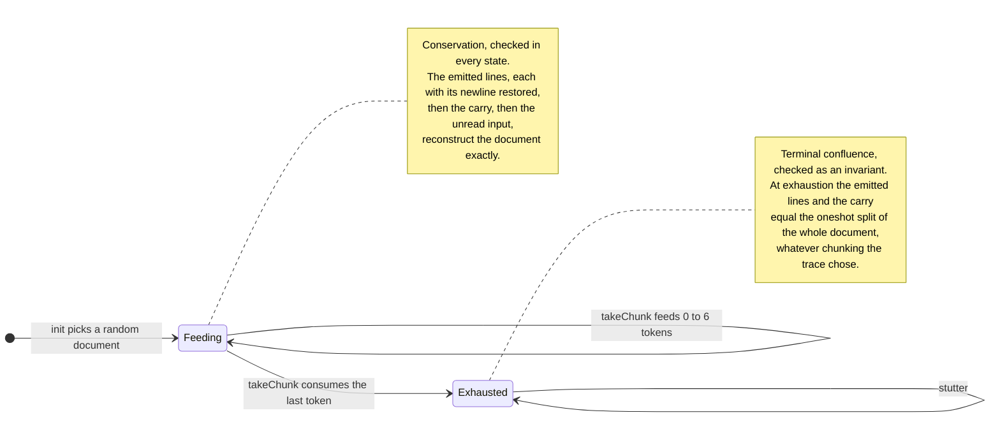
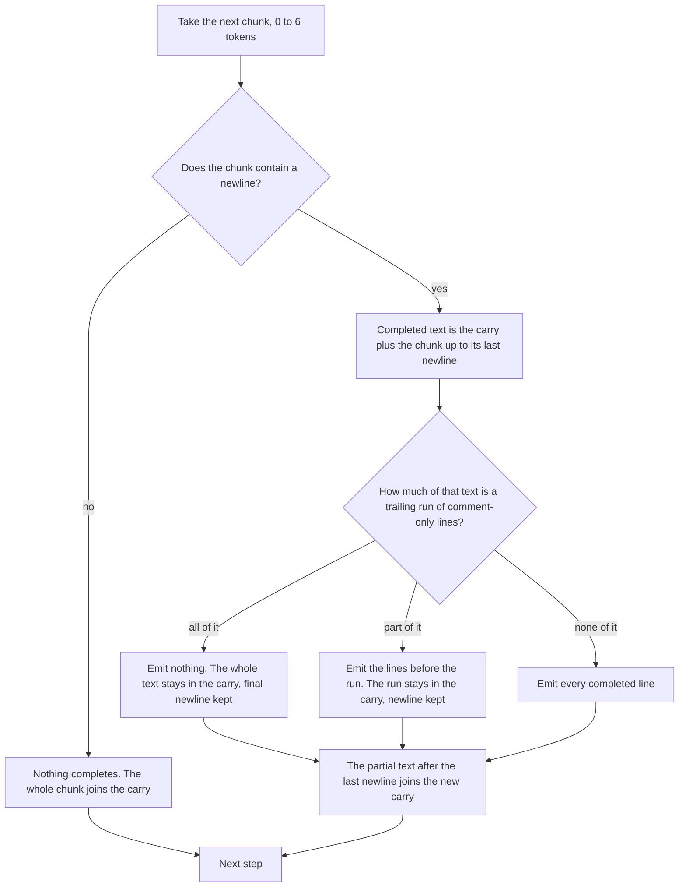

# Streaming line splitter: the carry-buffer machine

A companion to `streaming.qnt`. This spec is independent of the printer core: its whole universe is text, chunks, lines and a carry buffer.

## What it models

A G-code document arrives as a stream of arbitrarily sized chunks, and chunk boundaries can fall anywhere — mid-line, inside a slicer's comment block, or around an empty read. The splitter keeps an unfinished tail in a carry buffer, emits a line only once its terminating newline has arrived, and holds back a trailing run of comment-only lines until a non-comment line closes it.

The document is a list of integer tokens over a 5-letter alphabet, mapped 1:1 to characters by the replay: `0 → 'a'`, `1 → 'b'`, `2 → ' '` (blank), `3 → ';'` (comment opener), `4 → '\n'` (separator). A trace therefore doubles as a chunking schedule: the replay rebuilds the exact chunk strings, drives the real `splitChunk` with them, and compares the emitted lines and the carry after every step.

The machine's state is one record `s` (document, cursor, carry, cumulative lines, plus a phase mode and a monotonicity ghost), advanced only by pure transition functions. A second record `ev` is the trace contract: what kind of step happened, the chunk it fed, and the lines it completed.

## The step loop

Each step either feeds the next chunk — whose size is chosen nondeterministically, zero included — or stutters once the document is exhausted, so `step` is always enabled. A zero-length document begins life already `Exhausted`. The `Feeding`/`Exhausted` phase is stored as a sum type in `s` and pinned to the cursor by the `phaseMatchesCursor` invariant, so a mis-transcribed transition cannot silently desynchronize mode and progress.

## Inside one step: the feed transition

A comment-only line is one whose first non-blank character is the `;` opener. One accounting refinement is pinned by the spec: a step that completes nothing but still consumes a newline records a single empty line. That is what makes conservation exact.

## Decisions and reasoning

### Confluence is an invariant, not a scripted run

**Decision.** `terminalConfluence` is a checked invariant: whenever the cursor reaches the end of the document, the emitted lines equal the `oneshot` ghost's lines and the carry equals the oneshot carry.

**Reasoning.** Confluence — chunking never changes the result — is this machine's headline theorem. As an invariant it is quantified over every document and every chunking the simulator explores, and the replay re-checks it against the real splitter at every trace exhaustion.

**Alternatives considered.** A temporal property under `quint verify` would state it more directly, but there is no JVM on this machine and the invariant form is equivalent here because exhaustion is absorbing. Checking terminal agreement in a single hand-built scripted run; rejected — a run covers one document and one chunking, while the invariant is quantified over every document and every chunking the simulator explores.

### Two state variables, pure transitions

**Decision.** Exactly `var s: SpecState` and `var ev: Event`; actions only record `ev` and set `s' = applyChunk(s, chunk)` or `s' = applyStutter(s)`.

**Reasoning.** Pure transitions are unit-testable, reusable by ghosts (the `oneshot` ghost is literally `feed` applied once), and leave no frame conditions to get wrong. Invariants range over `s` only, so refactoring the trace contract cannot weaken a correctness claim.

**Alternatives considered.** Splitting the semantic machine and the trace contract into two modules; rejected as overweight for a one-function machine. Scattered scalar variables primed individually in every action; rejected — every action would carry frame conditions to get wrong, and invariants could no longer range over `s` alone.

### Sum types inside, plain strings in the event

**Decision.** `Phase` and `EvKind` are sum types; the only string is `ev.kind`, derived from `EvKind` in one place (`kindStr`).

**Reasoning.** Illegal phases are unrepresentable, so no well-formedness invariant is needed. ITF files and the replay still see plain `"init" | "chunk" | "stutter"` strings, which keeps the harness trivial.

**Alternatives considered.** Deriving the phase from the cursor on demand instead of storing it; storing it plus the `phaseMatchesCursor` invariant was chosen precisely so a transition transcription error has one more way to fail. A string-typed step kind with its domain documented in a comment; rejected — illegal values would be representable and need a well-formedness invariant.

### Documents sized to the step budget

**Decision.** Documents are 100–120 tokens, chunks are uniform 0–6 tokens, traces run 40 steps.

**Reasoning.** Chunks average 3 tokens, so 40 steps consume about 120. Most documents exhaust in the trace's final quarter: nearly every step is chunk work, terminal confluence is exercised in most traces, and only a short stutter tail remains. The newline weight in the token bag (2/7) keeps lines short, so chunk boundaries cross line and comment-run boundaries constantly.

**Alternatives considered.** Ending traces at exhaustion would eliminate stutters entirely, but `quint run` has no early-stop on a state predicate; resampling a fresh document on exhaustion would break the per-trace confluence story. Short documents of around 10 tokens; rejected — at 3 tokens per chunk the document exhausts within a few steps and the rest of the trace is stutters.

### Degenerate documents live in the semantic runs

**Decision.** The random corpus draws only long documents; the empty document and the newline-free document are covered by `emptyDocTest` and `noNewlineAllCarriedTest`.

**Reasoning.** A 0- or 4-token document inside a 40-step trace is 90%+ stutter padding. Deterministic runs pin the degenerate behavior without burning trace budget.

**Alternatives considered.** Keeping short lengths in the bag at low weight; rejected because each short draw costs a whole trace.

### One emitted line per consumed separator

**Decision.** Emitted-line accounting records one line per consumed newline, so an empty completion that consumed a separator is one empty line.

**Reasoning.** This makes conservation exact — lines re-terminated, then carry, then unread input, is the document — and gives the replay a derivation of step lines from `splitChunk`'s string outputs that cannot drift from the spec's.

**Alternatives considered.** Recording `complete.split('\n')` unconditionally would fabricate a phantom empty line on non-completing steps.

## Compared vs ignored

The replay in `src/__tests__/split-chunk.ts` (`streaming spec trace replay`) drives the real `splitChunk` with each trace's exact chunk strings.

| Real-system observable                                    | Replay treatment                                                               |
| --------------------------------------------------------- | ------------------------------------------------------------------------------ |
| Lines completed by each call (`complete`, split exactly)   | Compared per step against `ev.emitted`                                          |
| Carry after each call (`tail`)                             | Compared per step against `s.carry`                                             |
| Cumulative emitted lines                                   | Compared per step against `s.lines`                                             |
| Tokens consumed (cursor)                                   | Compared integer-exactly (`===`) against `s.cursor`                             |
| Consumed text is the document prefix                       | Compared per step by string equality                                            |
| Oneshot agreement at exhaustion                            | Compared: real chunked output vs real `splitChunk('', doc)`                     |
| Separator accounting (0 or 1 newlines consumed per call)   | Asserted as a replay-side sanity check                                          |
| `Parser` behavior on the emitted lines                     | Ignored — downstream of the splitter; owned by the parser suites                |
| Real slicer comment texts (`;LAYER_CHANGE`, `;Z:` …)       | Ignored — the alphabet has one opener; real texts live in the hand-written unit tests |
| Timing, backpressure, chunk arrival order                  | Ignored — transport concerns; chunks are contiguous document slices by model    |

No millimeter quantities appear in this machine, so the shared helper's `centiMismatch` is unused here; every number is a token count compared with `===`.

## Out of model

The splitter operates on decoded strings, so everything numeric about G-code is out of scope by construction: floats, fractional words, NaN and non-finite words belong to the interpreter spec and to `src/__tests__/interpreter.ts` and `src/__tests__/parser.ts`.

Closer to home, the model cannot express: `\r` (no CRLF handling is a pinned decision — a `\r` travels inside a line's characters; the hand-written describes in `src/__tests__/split-chunk.ts` exercise real strings), tabs and non-space blanks (the implementation's `trimStart()` trims all leading whitespace; the model's only blank is `' '`), multi-byte/UTF-8 chunk boundaries (decoded upstream by `TextDecoderStream` before the splitter sees text), and the end-of-stream flush of the final tail into the parser (owned by the stream driver and tested in the `streaming across a chunk boundary` describe of `src/__tests__/split-chunk.ts`).

## Trace budget

Sized to this machine's diameter: **20 traces × 40 steps × 2 seeds** (`0x67c0de2026` first, then `0xfab1e2026`), generated with `npx quint run --invariant allInvariants --max-steps 40 --n-traces 20 --out-itf 'verification/quint/traces/streaming/trace_<seed-tag>_{seq}.itf.json'` per seed.

Stated minima and measured counts over the committed corpus of 40 traces (1600 post-init steps):

| Metric                                   | Minimum | Measured    |
| ---------------------------------------- | ------- | ----------- |
| Stutter share of steps                   | ≤ 10%   | 8.6% (138)  |
| Chunk-work steps                         | ≥ 500   | 1462        |
| Steps emitting at least one line         | ≥ 150   | 572         |
| Lines emitted in total                   | ≥ 400   | 1220        |
| Steps ending with a held comment run     | ≥ 40    | 478         |
| Empty-chunk steps                        | ≥ 20    | 232         |
| Traces reaching exhaustion (confluence)  | ≥ 20    | 32          |

## Open items

`quint verify` has not been run — there is no JVM on this machine. Constructs suspected verify-hostile for a future Apalache lane: `oneOf` over `setOfMaps(0.to(119), …)` in `init` (an astronomically large function set that the simulator samples lazily but a checker must encode), the tuple-accumulator `foldr` in `trailingCommentRun`, and the growing unbounded lists (`doc`, `lines`) whose lengths only the `LenBag` constants bound.

Confluence here is terminal-state agreement under the model's chunkings; pairwise agreement between two *different* chunkings of the same random document is implied by it (both equal the oneshot) but is not stated as a two-machine product invariant. OPEN: the streamed-vs-oneshot equivalence of the full pipeline (parser metadata, Job) is a different machine entirely and remains unspecified.

Traces whose document outlives the 40-step budget (8 of 40) skip the confluence check by design; their steps still verify every per-step observable.
