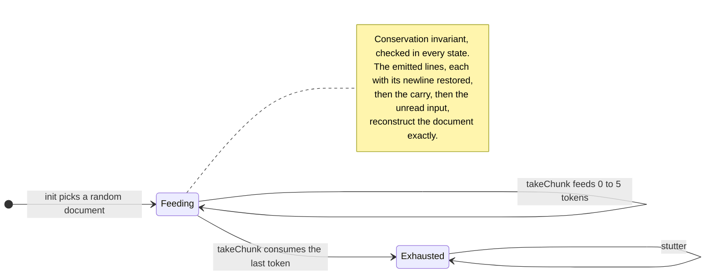

# Streaming line splitter: the carry-buffer machine

A diagram companion to `streaming.qnt`.

The spec models how a G-code document, arriving as a stream of arbitrarily sized chunks, is cut into complete lines. Chunk boundaries can fall anywhere — mid-line, inside a comment block, or around an empty chunk — so the machine keeps an unfinished tail in a carry buffer and emits a line only once its terminating newline has arrived.

## The step loop

Each step either feeds the next chunk — whose size is chosen nondeterministically, zero included — or stutters once the document is exhausted, so a step is always enabled. A zero-length document begins life already exhausted.

## Inside one step: the feed transition

A comment-only line is one whose first non-blank character is the `;` comment opener. Trailing runs of such lines are deliberately held back, terminating newline included, until a non-comment line closes the run — so a chunk boundary inside a comment block emits nothing yet.

One accounting refinement is pinned by the spec: a step that completes nothing but still consumes a newline records a single empty line. That is what makes conservation exact.

## What the other invariants pin down

The emitted lines are always a prefix of what a single oneshot feed of the whole document would produce, so chunking never changes the result. Every newline-terminated line sitting inside the carry is comment-only — nothing else is ever held back. And no emitted line contains the newline that completed it.
