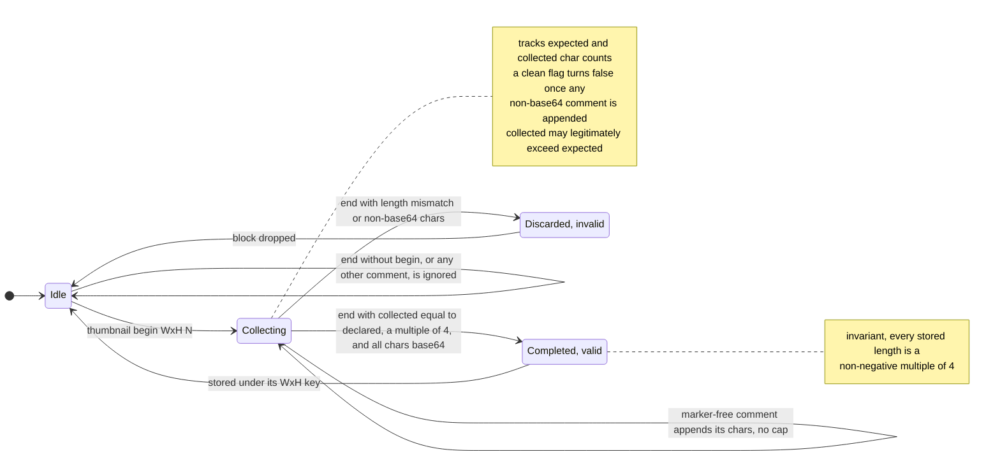

# Thumbnail comment protocol

A companion to `thumbnail.qnt`, which models the embedded-thumbnail protocol that slicers write into G-code comments. The machine watches the comment stream for `thumbnail begin WxH N` and `thumbnail end` markers, accumulates the payload lines in between, and keeps a finished thumbnail only when the collected characters pass the length and base64 checks.

Both outcomes of `end` clear the in-progress block and return to idle, where the spec's invariant pins every counter back to zero and the clean flag back to true.

Two quirks are modeled deliberately, not idealized away. Appends have no cap, so the collected count can overshoot the declared count and the mismatch is only caught at `end` (the spec explicitly refuses `collected <= expected` as an invariant). And finished thumbnails are keyed by their `WxH` size, so a later thumbnail with the same dimensions silently overwrites the earlier one.
