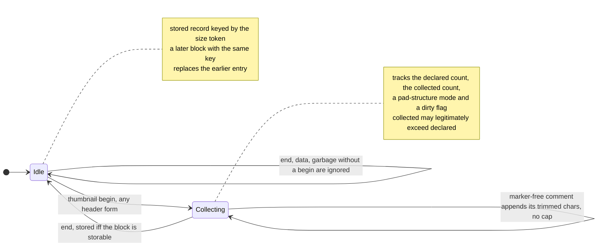
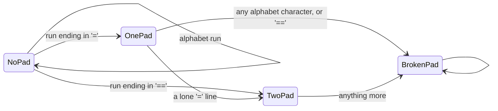

# Embedded thumbnails, v2: the comment-protocol collector

A companion to `thumbnail.qnt`. This machine is independent of the printer core: its whole universe is comment lines, character counts and a size-keyed record of finished thumbnails.

## What it models

Slicers embed preview images in G-code comments: a `thumbnail begin <size> <count>` marker, a run of base64 payload comments, and a `thumbnail end` marker. The library's parser collects everything between the markers and keeps the finished thumbnail only when the collected characters match the declared count and the base64 shape — padded `=` endings included.

The payload is abstract. A data line is carried as two counts — an alphabet-character run and a trailing `=` pad run — and a garbage line as the trimmed length of a comment holding at least one non-base64 character. The replay turns those counts back into concrete characters drawn from the full base64 alphabet, so a trace doubles as a comment stream whose exact lines drive the real parser.

Begin headers come in four observable forms, all pinned from the implementation's coercions: the full `WxH N` header; a header with no count (its declared length coerces to an unmatchable value, so the block can never store); a header whose size token has no parsable dimensions but does carry a count (it can store, under that token, with coerced dimensions); and a bare `thumbnail begin` (empty size token, no count).

The machine's state is one record `s` — the in-progress block, the stored record, and the ghosts — advanced only by pure transition functions. A second record `ev` is the trace contract in plain values.

## The block lifecycle

## Pad structure, tracked as a mode

The base64 shape allows `=` only as a trailing run of one or two. The block tracks that as a four-value mode; any alphabet character after a pad, or a third pad, breaks it for the rest of the block.

A block is storable at `end` exactly when the collected length equals the declared count, is a multiple of 4, no non-base64 character was appended, and the pad mode is not broken. On the model's payload language this predicate coincides with the implementation's base64 regex: with a contiguous trailing pad run of one or two, a total length divisible by 4 makes the alphabet prefix `4k+3` or `4k+2` — the regex's padded final quartet.

## Decisions and reasoning

### Payload as character classes, not one filler

**Decision.** Data lines carry an alphabet count and a pad count; garbage lines carry a trimmed length. The replay renders alphabet runs by cycling through all 64 base64 characters and appends the declared `=` run.

**Reasoning.** Validity now depends on payload structure the model actually tracks — pad placement and character class — so the implementation's regex is exercised in padded and unpadded forms, and the replay compares the stored `chars` content exactly instead of only its length.

**Alternatives considered.** Carrying concrete characters per line in the event (heavier traces for no added distinguishing power); testing the regex equation in a separate unit suite only (leaves the collector's interaction with padding unpinned).

**What v1 did.** Every data line was N copies of one filler character with no `=`, so validity collapsed to `length % 4 == 0 && clean` and the regex's padded forms were never sampled.

### Malformed begin headers are modeled forms

**Decision.** Four header forms — full, no-count, dimensionless-size-with-count, bare — each with its pinned coercions (unmatchable declared length, coerced dimensions, empty size token).

**Reasoning.** The implementation distinguishes them observably: they differ in the in-flight block's size, width, height and declared length, and in whether the block can ever store. Pinning them makes header-parsing regressions visible to the replay.

**Alternatives considered.** Modeling only the well-formed header and excluding the rest; rejected because the forms are reachable from real files and their behavior is part of the machine's surface.

**What v1 did.** Only well-formed `WxH N` headers existed in the model.

### Two state variables, pure transitions, sum types inside

**Decision.** Exactly `var s` and `var ev`; actions record `ev` and apply a pure `apply*` function. Phases, pad modes, declarations, size keys and header forms are sum types; the only strings live in `ev`, derived in one place.

**Reasoning.** Illegal states (a pad mode outside the four values, a phase string typo) are unrepresentable, so no well-formedness invariants are needed; the pure transitions are reusable by the runs and leave no frame conditions to get wrong.

**What v1 did.** Twelve scattered scalar vars with `keepProgress`/`keepStored` frame actions and stringly-typed `cmd`/`phase`.

### Ghosts make the transitions falsifiable

**Decision.** An append log (`ghostAppends`) re-derives the collected count line by line; `ghostPadChars` pins the pad mode to an independent `=` count; the outcome counters (stores, padded stores, replacements, drops, discards, garbage hits) carry conservation invariants (`storedCountConservation`, `storesMonotone`); `ghostPrevStores` freezes the previous store count so monotonicity is a checked claim, not a comment.

**Reasoning.** v1's invariants were bookkeeping a wrong transition would still satisfy. Here a mis-added append, a mis-pinned pad transition or a duplicated store entry each fail a dedicated invariant within milliseconds of simulation.

**What v1 did.** `phaseWellFormed`, `countersNonNegative` and a stored-lengths check — none could fail without editing the spec itself.

### The stored record is a keyed list

**Decision.** `stored` is a list of `{ key, len }` entries with put-replace semantics, plus a keys-unique invariant, instead of a Quint map.

**Reasoning.** ITF serializes maps as `#map`/`#tup` structures the shared replay helpers do not decode; a list of records keeps the replay on `itfList`/`itfRecord` only. The uniqueness invariant preserves the map law.

**What v1 did.** A `(int, int) -> int` map, decoded by a bespoke `#map`/`#tup` decoder copy-pasted into the suite.

### Deficit-aimed fills keep rare modes measurable

**Decision.** Two weighted step kinds aim a data line exactly at the declared count's remaining deficit (one of them ending with a pad run), and close the block when it already sits on its declared count; weights live in data (`STEP_MENU`).

**Reasoning.** Independent random lines almost never hit the declared count exactly — v1's corpus replayed only 3 successful stores in 375 states. Aimed fills make stores, padded stores and same-key replacements corpus-measurable while free data, garbage and ends keep every mismatch mode flowing.

**Alternatives considered.** Uniform step choice with a much larger corpus (thousands of traces to clear the same minima); post-filtering generated traces (breaks the manifest's exact reproduction).

**What v1 did.** A `1.to(20).oneOf()` if-chain with percentages in comments, and no aimed fills.

## Compared vs ignored

The replay in `src/__tests__/parse-thumbnail.ts` (`thumbnail v2 spec trace replay`) rebuilds each event as a concrete line and feeds it to one real `Parser` per trace.

| Real-system observable                                    | Replay treatment                                                            |
| --------------------------------------------------------- | --------------------------------------------------------------------------- |
| In-progress block present/absent                           | Compared every step against `s.progress`                                     |
| In-flight `size`, `width`, `height`                        | Compared exactly, coerced-NaN forms included (`toBe` is `Object.is`)         |
| In-flight `charLength` (NaN when the header had no count)  | Compared exactly                                                             |
| In-flight `chars` content and length                       | Compared exactly against the fed payload and `collected`                     |
| Stored keys (the `metadata.thumbnails` record)             | Compared as sorted key sets every step                                       |
| Stored `width`/`height`/`charLength`/`chars.length`        | Compared exactly per entry                                                   |
| Stored `chars` content                                     | Compared exactly against the payload recorded at the storing step            |
| Stored `isValid`                                           | Asserted true for every stored entry                                         |
| `src` data-URL prefix                                      | Ignored — a pure getter over `chars`, pinned by the v1 unit tests            |
| Real slicer thumbnail blocks (PNG payloads, QOI variants)  | Ignored — representative payloads only; real blocks live in the v1 unit tests |
| Chunk-straddled blocks (`parseGCode` call boundaries)      | Ignored here — one line per call pins persistence; multi-line chunk shapes stay with the v1 unit tests |

No millimeter quantities appear in this machine, so the shared helper's `centiMismatch` is unused; every number is a character count or pixel dimension compared with `toBe`.

The replay decodes one ghost, `ghostStores`: it marks the exact step a block is stored, which the stored record alone cannot show when a same-key same-length block replaces an earlier one (the implementation swaps the `chars` content; the spec's record is unchanged).

## Out of model

Comment extraction is upstream of this machine: the comment text is the span between the line's first and second semicolons, trimmed. Consequently whitespace-only comments never reach the collector (a data line is never empty), payloads containing `;` are inexpressible, and markers buried at non-canonical positions inside longer comments — the implementation matches the marker substring anywhere — are excluded and pinned only in the canonical leading position.

Within one data line, `=` appears only as a trailing run of at most two; an `=` sandwiched between alphabet characters on the same line is out of model (the cross-line sandwich — a pad line followed by an alphabet line — is in model and breaks the pad mode). The dimensionless size header has one fixed representative token (`qq`); other unparsable size shapes coerce identically and are excluded. Payload decoding to pixels, `Thumbnail.src` consumers and rendering are downstream of the parser and out of scope.

## Trace budget

Sized to this machine's block diameter (a begin/fill/end cycle is 3–6 steps, so 40 steps hold several full blocks): **25 traces × 40 steps × 2 seeds** (`0x67c0de2026` first, then `0xfab1e2026`), generated with `npx quint run verification/quint/thumbnail.qnt --invariant allInvariants --max-samples 25 --n-traces 25 --max-steps 40 --seed=<seed> --out-itf 'verification/quint/traces/thumbnail/trace_<seed-tag>_{seq}.itf.json' --verbosity 1` per seed, reproduced exactly by the manifest in `scripts/quint-specs.mjs`.

Stated minima and measured counts over the committed corpus of 50 traces (2000 post-init steps):

| Metric                                                      | Minimum | Measured |
| ----------------------------------------------------------- | ------- | -------- |
| Successful stores                                           | ≥ 40    | 63       |
| Stores with a padded (`=`/`==`) ending                      | ≥ 10    | 15       |
| Same-key stored replacements                                | ≥ 3     | 6        |
| Begins while collecting (block discarded and replaced)      | ≥ 40    | 87       |
| Ends while collecting that drop on length/declaration       | ≥ 60    | 125      |
| Ends while collecting that drop on shape alone (length matched) | ≥ 3 | 7        |
| Garbage lines appended into an open block                   | ≥ 20    | 33       |
| Malformed begin headers fed (no-count + dimensionless + bare) | ≥ 50  | 91       |
| Ends without a begin (no-ops)                               | ≥ 100   | 274      |
| Data lines carrying a pad run                               | ≥ 100   | 415      |
| Traces replaying at least one store                         | ≥ 25    | 37       |

v1's uniform 15×24 single-seed corpus replayed 3 stores, no padded form and no replacement.

## Open items

The in-progress block lives in a private parser field with no public accessor, so the replay keeps v1's structural peek (`(parser as unknown as { thumb?: Thumbnail }).thumb`). OPEN: if the implementation ever grows an internal test accessor for the in-flight thumbnail, the peek should move onto it; until then mid-flight phases stay publicly unobservable and the peek is the only binding for the collecting state.

`quint verify` has not been run — there is no JVM on this machine. The growing lists (`stored`, `ghostAppends`) are bounded only by the step budget, which an Apalache lane would need explicit bounds for.

Every temporal claim in the spec is a checked invariant (`storesMonotone` for the never-decreasing store count); the overshoot behavior — collected exceeding declared — is deliberately not an invariant, as the spec comment records.
